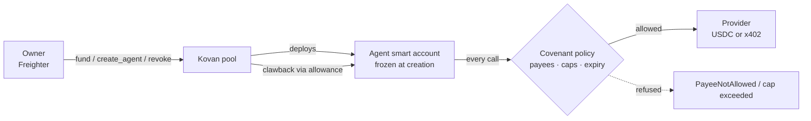

# Kovan

Shared USDC budgets your AI agents can't overspend.
> **Testnet only.** Hackathon prototype on Stellar testnet. Testnet USDC has no value. Not audited. Not a financial product. Not legal advice.

HackMeridian 2026 · Lisbon · Track: Genesis + Stellar Composed ("Agents that spend")

## Live URL + video

| Item | Link |
|---|---|
| Website | <https://kovan-protocol.vercel.app> |
| Agent install / guide | `/plugin install kovan --marketplace kovan-protocol/kovan` (Claude Code) · <https://kovan-protocol.vercel.app/agent.md> (any agent) |
| Signing page (for cloud agents) | <https://kovan-protocol.vercel.app/sign> |
| Demo video (2–4 min) | TBD |
| Backup video (unlisted) | TBD |
| Deck | TBD |

## One-liner

**Kovan gives AI agents their own on-chain spending covenant.** An owner locks USDC in one pool; each agent gets a Stellar smart account that only pays approved recipients, within per-payment and total caps, until an expiry. Signers and allowlists are fixed at creation, the owner can revoke and claw funds back at any time, and the same rules apply to direct and x402 payments.

## Problem

Agents that spend need money to spend. Today you hand the agent a funded wallet and hope, or refill it by hand. A buggy, looping or prompt-injected agent can empty whatever it holds, and it has happened: one manipulated prompt got the Freysa agent to release its ~$47K prize pool ([OECD AI incident](https://oecd.ai/en/incidents/2024-11-29-2e31)), and malicious prompts made the AIXBT agent send 55.5 ETH, about $105K ([Decrypt](https://decrypt.co/310510)).

## User

A developer or company running agents that pay data, API or RPC providers per call over x402. The owner backs the agents with testnet USDC and sets their limits. B2B.

## Solution

1. The **owner** locks USDC in a **pool** (`fund`).
2. The pool **creates an agent**: it deploys an OpenZeppelin smart account with exactly one context rule (the agent's ed25519 key + the **covenant policy**) and no management rule. The signer, allowlists, and policy binding are fixed; the owner can amend numeric limits and expiry. The account grants the pool a USDC recovery allowance, valid for 3,000,000 ledgers from creation.
3. The agent **draws** up to its draw limit from the pool into its own account. The pool keeps the sum of all draw limits at or below what is locked.
4. Every outgoing call from the account goes through the covenant: USDC transfers only to allowlisted **providers** (x402 or direct) and **recipients**, within per-transfer and total caps, before **expiry**; allowlisted **contract calls**; the pool's lifecycle functions. Anything else, including calls on the account itself, is rejected.
5. An agent may **delegate** a narrower covenant to a child, carved out of its own remaining allowance.
6. The owner (or a parent) can **revoke** and **close**. The owner can **amend** numeric limits, pull funds back without the agent's key, and record dispute outcomes. Closing recovers the remaining wallet balance and settles consumed funding before releasing unused allocation.
7. Once all agents are closed, the owner can permanently **close the pool** (`close_pool`); the remaining USDC returns to the owner in the same transaction.

*Humans configure, agents only execute inside limits.*



### What's different

Earlier Stellar hackathon projects put spending limits on a single agent wallet. Kovan is the treasury layer around them:

- **One pool, many agents.** The contract guarantees the agents' draw limits never add up to more than the pool holds.
- **Frozen accounts.** The agent's account has no admin rule: nobody, including the agent and Kovan, can add a key or change who it pays. The owner can only adjust the numbers or revoke.
- **Clawback without the agent.** The owner pulls funds back through an allowance the account grants the pool at creation, even if the agent's key is lost or compromised.
- **Delegation.** An agent can give a sub-agent a narrower budget carved out of its own; revoking a parent freezes its children.
- **A smart-account x402 payer.** The standard Stellar x402 client signs only for classic accounts; Kovan builds the OpenZeppelin `AuthPayload` so a covenant-bound smart account can pay x402 endpoints.
- **Agent-native setup.** Agents create pools and agents themselves through a Claude Code plugin or a guide any agent can read; the owner approves each step in Freighter and the agent never holds the owner's key.

Pool accounting, permanent shutdown, the optional DeFindex yield source (built and tested against DeFindex's real vault code, not yet activated) and signer choices are documented in [docs/POOL.md](docs/POOL.md). Design: [covenant design](docs/superpowers/specs/2026-10-25-kovan-covenant-design.md) · [implementation plan](docs/superpowers/plans/2026-10-25-kovan-contracts.md).

## Architecture: how Stellar is used

| Component | Stellar feature | Contract ID (testnet) |
|---|---|---|
| `kovan-pool` | Accounting v2; USDC recovery; irreversible pool shutdown; deploys agent accounts via `deployer()` | [`CDP6UNP5YZ6NIMJ2XVQGYLBUAA5RP2LD7SPIRBP4VTVZLKPKCHFX42BR`](https://stellar.expert/explorer/testnet/contract/CDP6UNP5YZ6NIMJ2XVQGYLBUAA5RP2LD7SPIRBP4VTVZLKPKCHFX42BR) |
| `kovan-covenant-policy` | OpenZeppelin smart-account policy (`stellar-accounts` 0.8.0) | [`CDEQUCR4OHOQHWPIP5RONRR46G7DTJMFZKNKRIQJCLYACDDZGWKAISD2`](https://stellar.expert/explorer/testnet/contract/CDEQUCR4OHOQHWPIP5RONRR46G7DTJMFZKNKRIQJCLYACDDZGWKAISD2) |
| `kovan-agent-account` (per agent) | OpenZeppelin smart account, frozen at creation | unchanged wasm hash `25dabe1afc7a1ef93a0bc7b40ffa784e0a70463db91c4b1812fc155768ead2d7`; created on demand, not migrated |
| `kovan-ed25519-verifier` | OZ verifier for External signers | [`CAEU4VYRTV4ZDHFGCRYQNPN6URDOYLP4TS4OMRAJX5RD7AMLWBTYW6G4`](https://stellar.expert/explorer/testnet/contract/CAEU4VYRTV4ZDHFGCRYQNPN6URDOYLP4TS4OMRAJX5RD7AMLWBTYW6G4) |
| USDC | Stellar Asset Contract | `CBIELTK6YBZJU5UP2WWQEUCYKLPU6AUNZ2BQ4WWFEIE3USCIHMXQDAMA` |
| Payments | x402 (facilitator-settled `transfer` from the agent account) | see evidence |

Full deployment record: [deployments/testnet.json](deployments/testnet.json).

### Testnet transaction evidence

Current pool rollout (confirmed by Stellar RPC):

| Step | What it shows | Tx |
|---|---|---|
| upload pool v2 | Current pool WASM uploaded at ledger 5388770 | [`74ca13…`](https://stellar.expert/explorer/testnet/tx/74ca13c5799421ec314cf5fa3fd946e4f0cb91be4f990849592ed6338ac4186f) |
| deploy pool v2 | Fresh pool at ledger 5388771; verified `accounting_version: 2`, `closed: false`, zero balance and zero agents | [`b2b2f1…`](https://stellar.expert/explorer/testnet/tx/b2b2f1f8fd3911504f91a5d9f959ffdb61a24e1b9a9fa9c29b56965eb26074f5) |

Lifecycle evidence on the legacy pool [`CAS7ARNT…`](https://stellar.expert/explorer/testnet/contract/CAS7ARNTLTRAD4WLYGIXC5EVMFZBETIQROJ2UWOJGU4QQY5XQT3K2LKJ), with its first agent [`CAL7PY3A…`](https://stellar.expert/explorer/testnet/contract/CAL7PY3A56BEDAN4QKNR5GPKK2UGXRHXG2Y3BX3XH5OHRPWGZS6JCCLZ). Shared verifier and policy deployments remain in use.

| Step | What it shows | Tx |
|---|---|---|
| deploy | verifier, policy, pool (second deployment, after review fixes) | [`ff4977…`](https://stellar.expert/explorer/testnet/tx/ff4977411d20f7915c400ae4edb031241a4631872fc1d7459b7acc2fb5ac54dc) [`8b25ea…`](https://stellar.expert/explorer/testnet/tx/8b25ea4e8112195e72bf779bdd80cb1ba690fe6b00b5433d403799b5e56416fd) [`aeb089…`](https://stellar.expert/explorer/testnet/tx/aeb089402970cc503063bf223978f875aa829ec1b0e0d9adcaaff70d2f4b476c) |
| fund | Owner locks 5 testnet USDC in the pool | [`647e1a…`](https://stellar.expert/explorer/testnet/tx/647e1a6bcdd1c85dc7bb31a708ba04f745aa14ed35ba71e63308e399fcc9f8ff) |
| create agent | Pool deploys a frozen agent account ($0.50 draw limit); events show one `Default` rule with one External signer and the covenant policy, plus the USDC allowance to the pool | [`6ff00f…`](https://stellar.expert/explorer/testnet/tx/6ff00f25f92b27da9034383d606e9e56428d480ad30c10019ace6323649f1033) |
| draw | Agent `CDECNZ57…` (key generated by the console) moves 0.50 USDC from the pool into its own account; only the draw amount leaves | [`ec4c12…`](https://stellar.expert/explorer/testnet/tx/ec4c127758282c38e493fa79c726264c564541d36a1ad1fc0545423de7411479) |
| x402 payment | Agent pays Stellar's x402 demo endpoint 0.01 USDC: 402 → signed `AuthPayload` → settled by x402.org → protected content returned | [`781a5f…`](https://stellar.expert/explorer/testnet/tx/781a5f2b560df66d3d6c587ef4f2a283e82421ce16b54565a9a64a8ba662775d) |
| blocked payment | Agent tries to pay an address outside its covenant; the covenant refuses in `__check_auth` with `#3904 PayeeNotAllowed` before anything is submitted (no transaction exists, by design) | simulation only |
| direct payment | Agent pays an allowlisted provider 0.20 USDC directly (same covenant rule as x402) | [`263d05…`](https://stellar.expert/explorer/testnet/tx/263d05036ee5bcc7520cef1dc39fb36a85ab4c90d5eda2caa5a62e7d2b0f4fb0) |
| create agent (console key) | Agent created for a console-generated key | [`0980a4…`](https://stellar.expert/explorer/testnet/tx/0980a449e94c152f5f841130dc6fd36cbdad85cff5694beeacbeac81bf017166) |
| return funds | Agent returns 0.29 USDC to the pool | [`c455d6…`](https://stellar.expert/explorer/testnet/tx/c455d6a3229fe29f82ecd00d26de2d0c86ee76f365a8230bb96b153db71665b3) |
| delegate | Agent carves a child covenant | TBD on testnet; covered by contract tests (`delegate_carves_limit_from_parent`, `revoke_parent_revokes_children`, …) |

Full lifecycle with the standalone SDK on an isolated pool (testnet XLM as the asset, [details](docs/SDK.md)):

| Step | Tx |
|---|---|
| create pool → fund → create agent | [`02e719…`](https://stellar.expert/explorer/testnet/tx/02e7191ad9bda54e11e678eaa1e36387e35449fd429dc580600d453afa5669f6) [`80bde8…`](https://stellar.expert/explorer/testnet/tx/80bde86a4c685d189d1575670ea22d2f86018e8897730d2d44af1deffa24b8a0) [`a6181b…`](https://stellar.expert/explorer/testnet/tx/a6181b925c5ae6cec14dfba038e8324e221126c629cdbb9510645fa68699ff20) |
| draw → pay → return | [`2df385…`](https://stellar.expert/explorer/testnet/tx/2df38579aa272fc15c55a5b0b10b14c49fd4b16b05911c5b1fa4cefa5167b3ee) [`48b5c1…`](https://stellar.expert/explorer/testnet/tx/48b5c1114cf4c51a5de04554b14e3ec360997cffcfdb44d964409070fff61e23) [`748e25…`](https://stellar.expert/explorer/testnet/tx/748e25c5622233b090c5884ba3355b5d7a587041b22bded10015238a999e5447) |
| revoke (owner kill switch) | [`447cdd…`](https://stellar.expert/explorer/testnet/tx/447cdd0f2b1c7f36a64308f01295df39068935688f9930e986480ed8df765f8b) |
| close agent → withdraw → close pool | [`4d1eb6…`](https://stellar.expert/explorer/testnet/tx/4d1eb6b875096c799aefc9bbb6e7a50ce201e85a8330517c9fc4ea02a66969f4) [`cbf24d…`](https://stellar.expert/explorer/testnet/tx/cbf24d059313a2f036bef5066fbd2b3de002c48adb8256bab36ef75fadca41da) [`0a8d81…`](https://stellar.expert/explorer/testnet/tx/0a8d81a9006b5a53ec6676e0df72a99d0ce6a30812b65f075631db097accc0ae) |

## Setup

### Use with your agent

Install Kovan into your agent, then ask it in plain words, e.g. *"Set me up a $100 Kovan pool with 2 agents."*

```text
Claude Code:   /plugin install kovan --marketplace kovan-protocol/kovan
               (older versions: /plugin marketplace add kovan-protocol/kovan, then /plugin install kovan@kovan)
Any agent:     "Read https://kovan-protocol.vercel.app/agent.md and follow it."
```

The agent prepares every transaction itself with [`kovan.mjs`](skills/kovan/scripts/kovan.mjs), one self-contained Node file. Each owner action opens a small wallet page on `127.0.0.1` where you approve in Freighter. The agent never holds your key, and you check the real transaction in Freighter's own window. Agents spend with their own keys, inside their covenant. Agents running in the cloud use the hosted [signing page](https://kovan-protocol.vercel.app/sign) instead. Details: [skills/kovan/SKILL.md](skills/kovan/SKILL.md) · [signer/README.md](signer/README.md).

### Developer SDK

[`@kovan/sdk`](sdk/README.md) is a standalone local TypeScript/ESM package for deploying/funding pools, creating agents, authorized payments and recovery/closure. The dashboard uses the same SDK. Applications supply their own configuration and owner/agent/fee-payer signers; no Kovan backend or keystore is required. It is **not yet published to npm**. Yield remains experimental and inactive on the default v2 deployment.

```bash
cd sdk
npm ci
npm run build
npm test
# Read-only by default; --execute creates disposable testnet accounts and a new pool.
node examples/testnet-lifecycle.mjs
```

### Contracts and dashboard

Verification snapshot (2026-10-26, current `main`): **468 tests** pass: 132 contract, 251 dashboard, 48 SDK and 37 signer tests. One optional DeFindex-bytecode integration test is ignored by the default contract run and excluded from this total. Earlier snapshots: [docs/POOL.md](docs/POOL.md#earlier-test-snapshots).

```bash
rustup target add wasm32v1-none      # stellar CLI 26.1.0, cargo 1.95
make test                            # builds WASM and runs the contract tests
node dashboard/scripts/deploy-pool.mjs --check --source <identity> # read-only preflight (after build)
OWNER=<identity> make deploy         # testnet only; pool-only rollout when manifest exists
```

Run `make setup-js` to install/build the SDK and install the dashboard's local package dependency. `make test-js` rebuilds the SDK, refreshes that installed copy and checks both packages. The console runs locally (`cd dashboard && npm run dev`); see [dashboard/README.md](dashboard/README.md). With an existing manifest, deployment verifies the owner and unchanged shared code, archives the old manifest, deploys and verifies the new pool, and atomically updates the record while retaining legacy access. It does not move funds. Update the README's deployment evidence after a rollout, then run `cd web && npm run build` to synchronize the website snapshot.

## Env vars

Names in [.env.example](.env.example). Never commit real values.

## Demo

The video walks through the same flow you can run yourself on testnet:

1. **Set up by an agent.** In Claude Code with the plugin installed: *"Set me up a $100 Kovan pool with 2 agents."* The agent runs `kovan.mjs` (`connect`, `owner create_pool`, `owner fund`, `owner create_agent`), and the owner approves each step in Freighter.
2. **Spend.** The agent draws from the pool and pays an allowlisted provider, directly (`agent pay`) or over x402 from the console.
3. **Refuse.** A payment to an address outside the covenant, or above a cap, is refused before submission (`PayeeNotAllowed`, `PerTransferCapExceeded`).
4. **Delegate and revoke.** The agent carves a smaller budget for a child; the owner revokes the parent, which freezes both, and pulls the funds back to the pool.
5. **Close.** The owner closes the agents and the pool; the remaining USDC returns to the owner.

## Built during event vs prior work

The repository was created at 10:04 Lisbon on Sun Oct 25 with a one-line README. All code and documentation were written after the event started at 11:30 Lisbon. Before the event: planning docs only (kept outside this repository), and a throwaway x402 + smart-account proof of concept whose code was not reused. Third-party code: the OpenZeppelin ed25519 verifier example (stellar-contracts v0.8.0) and the Stellar Development Foundation's agent skills, vendored as reference for AI agents.

## AI usage

AI tools were used with attribution: every commit containing AI-written code starts with `[ai]`. See [AI_USAGE.md](AI_USAGE.md) for which tool built what. Owner keys are created and held by humans in their own wallets; agent signing keys are generated by software (the console or `stellar keys generate`), never pasted into AI chats or committed. Design decisions were made in conversation and recorded in the design doc.

## Compliance by design

B2B and non-custodial: owners sign in their own wallets and agents hold their own keys. No token issued, no promised returns, no personal data on-chain. Testnet only; mainnet only after an audit and business (KYB) onboarding. Not legal advice.

## Roadmap

- x402 payments built into the agent tool, and the SDK published to npm.
- An MCP server, so any MCP-capable agent can use Kovan without running a script.
- Live DeFindex yield on idle pool funds, once a vault accepts Circle's testnet USDC.
- On-chain payment mandates, and co-signing for large or unusual payments.
- Agent reputation (stellar-8004) and limits that grow with good behaviour.
- Mainnet after an audit, with KYB onboarding.

## Team

*Names and roles to be added by the team.*

## License

[MIT](LICENSE).

## Testnet disclaimer

Hackathon prototype on Stellar **testnet only**. Testnet USDC has no value. Not audited. Not a financial product. Not legal advice.
