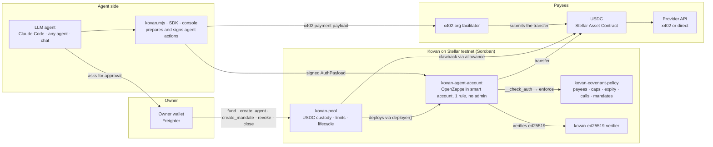
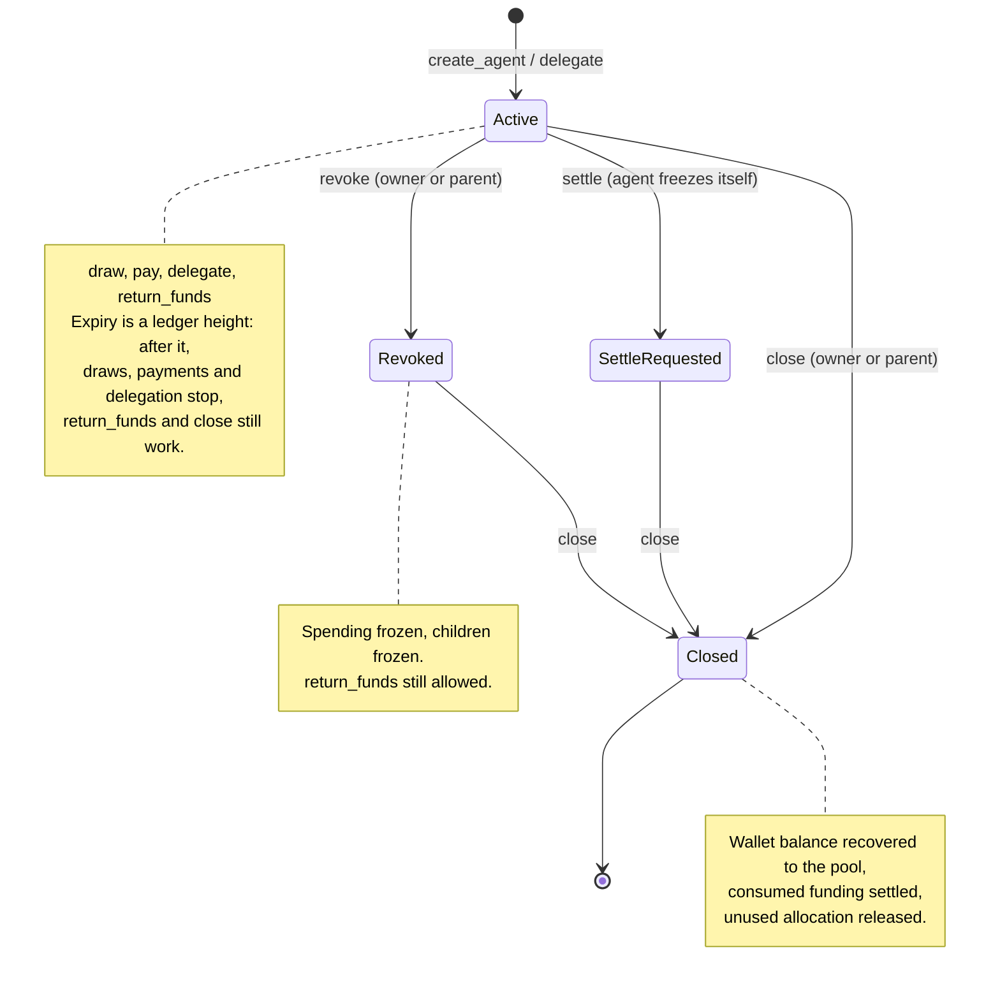
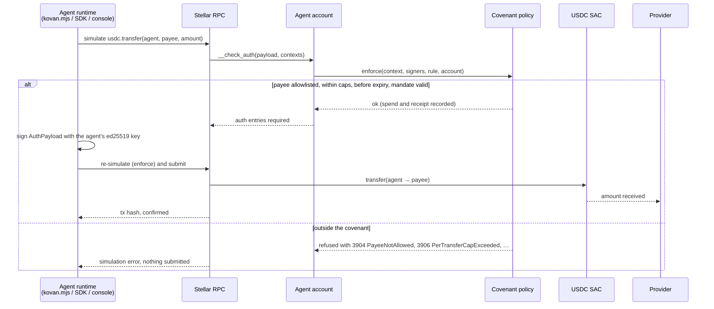
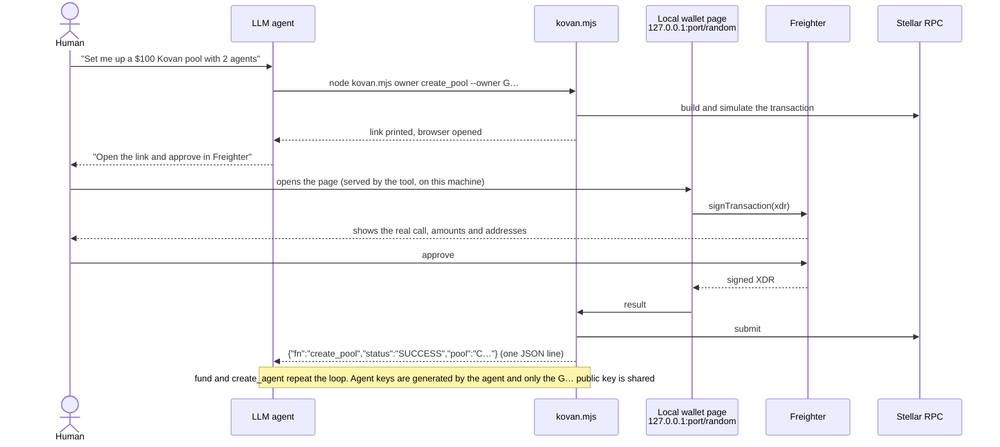
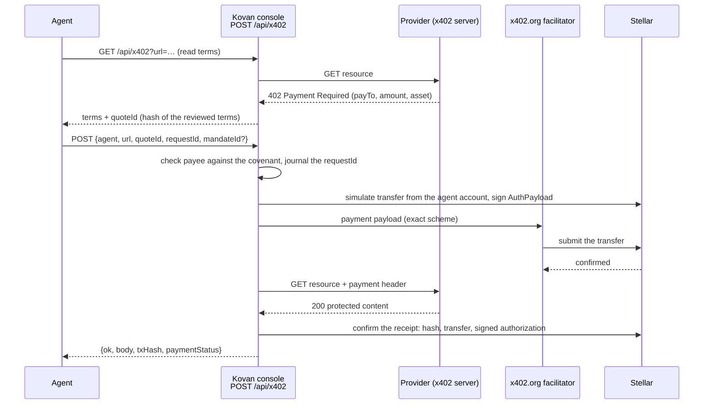

<div align="center">

# Kovan

**Shared USDC budgets your AI agents can't overspend.**

One pool funds many agents. Each agent gets its own Stellar smart account, bound to an on-chain covenant: who it may pay, how much per payment, how much in total, and until when. The rules are enforced by the agent's own account, so no bug, loop or prompt injection can talk its way past them.

[](https://stellar.org)
[](https://developers.stellar.org/docs/build/smart-contracts)
[](https://github.com/OpenZeppelin/stellar-contracts)
[](https://x402.org)
[](https://www.npmjs.com/package/@kovan-protocol/sdk)
[](#testing)
[](https://github.com/kovan-protocol/kovan/actions/workflows/signer-pages.yml)
[](./LICENSE)

[Website](https://kovan-protocol.vercel.app) · [Try it with your agent](#use-with-your-agent) · [Live demo](https://kovan-protocol.vercel.app/playground) · [Deck](docs/kovan-pitch-deck.pdf) · [Evidence](#testnet-transaction-evidence) · [API reference](#api-reference) · [Security model](#security-model)

HackMeridian 2026 · Lisbon · Track: Genesis + Stellar Composed ("Agents that spend")

---

</div>

> **Testnet only.** Hackathon prototype on Stellar testnet. Testnet USDC has no value. Not audited. Not a financial product. Not legal advice.

## Table of contents

- [Overview](#overview)
  - [The problem](#the-problem)
  - [The user](#the-user)
  - [One-liner](#one-liner)
  - [What's different](#whats-different)
- [Live URL and deck](#live-url-and-deck)
- [Core features](#core-features)
- [Architecture: how Stellar is used](#architecture-how-stellar-is-used)
- [How it works](#how-it-works)
  - [Pool and agent lifecycle](#pool-and-agent-lifecycle)
  - [A payment, allowed or refused](#a-payment-allowed-or-refused)
  - [Owner approval without sharing keys](#owner-approval-without-sharing-keys)
  - [x402 from a smart account](#x402-from-a-smart-account)
  - [Payment mandates](#payment-mandates)
- [Specs at a glance](#specs-at-a-glance)
- [Testnet transaction evidence](#testnet-transaction-evidence)
- [Quick start](#quick-start)
  - [Use with your agent](#use-with-your-agent)
  - [Developer SDK](#developer-sdk)
  - [Run the console locally](#run-the-console-locally)
  - [Build and test the contracts](#build-and-test-the-contracts)
- [Project structure](#project-structure)
- [API reference](#api-reference)
- [Environment variables](#environment-variables)
- [Technology stack](#technology-stack)
- [Security model](#security-model)
- [Deployment](#deployment)
- [Demo](#demo)
- [Built during event vs prior work](#built-during-event-vs-prior-work)
- [AI usage](#ai-usage)
- [Compliance by design](#compliance-by-design)
- [Roadmap](#roadmap)
- [Team](#team)
- [License](#license)
- [Testnet disclaimer](#testnet-disclaimer)

---

## Overview

### The problem

Agents that spend need money to spend. They buy data, APIs and compute per call, increasingly over [x402](https://x402.org). Today you hand the agent a funded wallet and hope, or refill it by hand. A buggy, looping or prompt-injected agent can empty whatever it holds, and it has happened: one manipulated prompt got the Freysa agent to release its ~$47K prize pool ([OECD AI incident](https://oecd.ai/en/incidents/2024-11-29-2e31)), and malicious prompts made the AIXBT agent send 55.5 ETH, about $105K ([Decrypt](https://decrypt.co/310510)).

### The user

A developer or company running agents that pay data, API or RPC providers per call. The owner backs the agents with USDC and sets their limits; the agents run without manual top-ups. B2B, non-custodial.

### One-liner

**Kovan gives AI agents their own on-chain spending covenant.** An owner locks USDC in one pool; each agent gets a Stellar smart account that only pays approved recipients, within per-payment and total caps, until an expiry. Signers and allowlists are fixed at creation, the owner can revoke and claw funds back at any time, and the same rules apply to direct and x402 payments.

*Humans configure, agents only execute inside limits.*

### What's different

Earlier Stellar hackathon projects put spending limits on a single agent wallet. Kovan is the treasury layer around them:

| | Kovan | A single capped wallet |
|---|---|---|
| **Budget source** | One pool backs many agents; the contract guarantees the agents' draw limits never add up to more than the pool holds | One wallet per agent, funded by hand |
| **Who can change the rules** | Nobody. The account has no admin rule; the owner can only tighten or loosen numbers, or revoke | Usually the deployer, sometimes the agent |
| **Lost or stolen agent key** | Owner pulls funds back through an allowance granted at creation, without the agent | Funds are gone or stuck |
| **Sub-agents** | An agent delegates a narrower budget carved out of its own; revoking a parent freezes its children | Not supported |
| **Payment intent** | Owner-approved mandates bind a payment to a purchase, with single-use IDs and on-chain receipts | Not supported |
| **x402** | A smart-account (C-address) payer; the standard Stellar client only signs for classic accounts | Classic account or none |
| **Setup** | The agent sets itself up (Claude Code plugin, `agent.md`, one link for chat assistants); the owner signs in Freighter | A dashboard |

---

## Live URL and deck

| Item | Link |
|---|---|
| Website | <https://kovan-protocol.vercel.app> |
| Agent install / guide | `/plugin install kovan --marketplace kovan-protocol/kovan` (Claude Code) · <https://kovan-protocol.vercel.app/agent.md> (any agent) |
| One-link setup (chat assistants) | <https://kovan-protocol.vercel.app/setup> |
| Signing page (cloud agents) | <https://kovan-protocol.vercel.app/sign> |
| TypeScript SDK | [`@kovan-protocol/sdk`](https://www.npmjs.com/package/@kovan-protocol/sdk) on npm |
| Live demo | <https://kovan-protocol.vercel.app/playground> (wallet-free simulation of caps, payees and revocation) |
| Deck | [Kovan pitch deck (PDF)](docs/kovan-pitch-deck.pdf) · generated version with speaker notes: [PDF](docs/pitch/kovan-pitch-deck.pdf) · [PPTX](docs/pitch/kovan-pitch-deck.pptx) · [HTML](docs/pitch/kovan-pitch-deck.html) · [pitch script](docs/pitch/PITCH.md) |
| Deployment record | [deployments/testnet.json](deployments/testnet.json) |

---

## Core features

### Shared pool with a hard invariant
The owner locks USDC in a Soroban pool (`fund`). `sum_limits ≤ locked` is enforced on every `create_agent`, `delegate` and `amend`, so agents can never be promised more than the pool holds. Only the drawn amount ever leaves the pool. Details: [docs/POOL.md](docs/POOL.md).

### Covenant policy
An OpenZeppelin smart-account policy checks every outgoing call from an agent account: USDC `transfer` only to allowlisted **providers** (per-call APIs, x402) and **recipients**, within per-transfer and total caps, before expiry; allowlisted **contract calls** with an optional amount cap; the pool's lifecycle functions. Anything else, including calls on the account itself, is refused inside `__check_auth`, before any money moves.

### Frozen agent smart accounts
The pool deploys one OpenZeppelin smart account per agent with exactly one context rule (the agent's ed25519 key + the covenant policy) and **no management rule**. Nobody, not the agent and not Kovan, can add a key or remove the policy. The owner can amend numeric limits and expiry through the pool.

### Owner kill switch and clawback
`revoke` freezes an agent and its children. `return_funds` and `close` pull USDC back into the pool without the agent's key. Recovery v1 renews the account's fixed pool/token allowance before recovering funds, even after its old allowance expires. Earlier immutable accounts retain their original finite allowance. `close_pool` is an irreversible shutdown that returns the remaining USDC to the owner.

### Delegation
An agent can `delegate` a child covenant carved out of its own remaining allowance. A child can't pay anyone its parent can't, can't exceed the parent's caps or expiry, and must close before its parent. The current release permits up to 16 direct children, depth 4 (root at 0), and 17 lifetime agents per root family. Closed descendants still count, keeping recursive revocation bounded.

### Payment mandates (current release)
Owner-approved grants, `exact` (one payment to one payee for one amount and reference) or `budget` (payees, per-payment and total caps), each with an intent hash, deadline and single-use payment IDs. New agent accounts require a mandate for outgoing payments; the policy stores an on-chain receipt per payment. This is native Kovan enforcement, not AP2 credentials or proof of delivery. Details: [docs/MANDATES.md](docs/MANDATES.md).

### x402 from a smart account
The standard `@x402/stellar` client signs only for classic accounts. Kovan builds the OpenZeppelin `AuthPayload` for the agent's smart account, settles through the x402.org facilitator, binds the reviewed quote to the payment, keeps a persistent request journal so retries never pay twice, and confirms the receipt against Stellar RPC. Details: [docs/AGENTIC_SAFETY.md](docs/AGENTIC_SAFETY.md).

### Agent-native setup
Agents set Kovan up themselves: a Claude Code plugin, a guide any agent can read (`agent.md`), one self-contained Node tool (`kovan.mjs`), a hosted signing page for cloud agents and a one-link `/setup` page for chat assistants that can't run commands. The owner approves every owner action in Freighter; the agent never holds the owner's key.

### Owner console
A local Next.js console to create and select pools, lock USDC, create agents and mandates, run agent actions (draw, pay, x402, return), recover funds and close pools, with a live event log. Signing keys for app-managed agents stay on the owner's machine. Details: [dashboard/README.md](dashboard/README.md).

### Developer SDK
[`@kovan-protocol/sdk`](https://www.npmjs.com/package/@kovan-protocol/sdk): prepare → review → sign → submit for owners, agent authorization signing, reads, decoded contract errors and retries. No Kovan backend or keystore required. Details: [sdk/README.md](sdk/README.md), [docs/SDK.md](docs/SDK.md).

### Optional yield backing (built, not activated)
Pool v3 can invest idle USDC in a DeFindex vault and count 90% of the shares' value as agent backing, redeeming only what a draw needs. It is tested against DeFindex's real vault bytecode but deliberately not enabled: the published testnet vault uses a different USDC issuer. Details: [docs/YIELD.md](docs/YIELD.md).

---

## Architecture: how Stellar is used



### Components

The **historical default** pool (accounting v2) holds the earlier lifecycle evidence; the **current release** (accounting v3, mandate v1, recovery v1, published 2026-10-26 10:22 UTC) is what new pools use. The first native-mandate release is retained in `previous_releases`. Existing pools are immutable and keep their own code; the manifest's `current_release` supplies new-pool creation and the verifier is shared.

**Current default pool:** [`CBOOAYAVDNAKBAH2OE57O4FDQW4OKCTDJDNJ6MGYM5AP2L46VTGBCON6`](https://stellar.expert/explorer/testnet/contract/CBOOAYAVDNAKBAH2OE57O4FDQW4OKCTDJDNJ6MGYM5AP2L46VTGBCON6), deployed on 2026-10-26 at 10:35:47 UTC, ledger 5397472 ([confirmed transaction](https://stellar.expert/explorer/testnet/tx/df2e7860fa1c6fee39625563ae3c51a22e5ec2c0bd52e9fa719788b1a0c8e28a)). This is a fresh, empty instance of the current release, owned by the same `GCNN…HBOC` wallet. The dedicated testnet deployer paid the creation fee at the user's request; it has no pool-owner authority. The former default had 0 USDC and no agents, so no balance or agent migration was needed. Its bindings remain in `legacy_pools`; it was not deleted or closed. Funding and agent creation still require the owner's signature.

| Component | Stellar feature | Historical default (testnet) | Current release (testnet) |
|---|---|---|---|
| `kovan-pool` | Soroban contract: USDC custody, `sum_limits ≤ locked`, deploys agent accounts via `deployer()`, irreversible shutdown | [`CDP6UNP5…HFX42BR`](https://stellar.expert/explorer/testnet/contract/CDP6UNP5YZ6NIMJ2XVQGYLBUAA5RP2LD7SPIRBP4VTVZLKPKCHFX42BR) · WASM `cc1aadcf38ffeee5d15717e04f48f325024b7a47e57ca1548a8e9d49b731b464` | WASM `857f3a27fda736f842e5b4c548022a05197137650cc49f984dde141287175dc1` (new pools are created per owner) |
| `kovan-covenant-policy` | OpenZeppelin smart-account **policy** (`stellar-accounts` 0.8.0) | [`CDEQUCR4…GWKAISD2`](https://stellar.expert/explorer/testnet/contract/CDEQUCR4OHOQHWPIP5RONRR46G7DTJMFZKNKRIQJCLYACDDZGWKAISD2) | [`CA2NXNPD…HLVSMEN7`](https://stellar.expert/explorer/testnet/contract/CA2NXNPDGZ674K467K3K2IXV342BTPJ7YJRLVZPT4LCSJS5GHLVSMEN7) · WASM `40e94659788fb6c6af4cc97230572af99058465b02bb9bf5976040eddb6d345c` |
| `kovan-agent-account` | OpenZeppelin **smart account**, one per agent, created on demand | WASM `25dabe1afc7a1ef93a0bc7b40ffa784e0a70463db91c4b1812fc155768ead2d7` | WASM `909b66bf67a425308f832ceadc4aa49ef5862ce256533cec3b8a9e4fdab6ccf4` |
| `kovan-ed25519-verifier` | OpenZeppelin verifier for **External** signers | [`CAEU4VYR…MLWBTYW6G4`](https://stellar.expert/explorer/testnet/contract/CAEU4VYRTV4ZDHFGCRYQNPN6URDOYLP4TS4OMRAJX5RD7AMLWBTYW6G4) | same |
| USDC | **Stellar Asset Contract** (Circle testnet USDC) | `CBIELTK6YBZJU5UP2WWQEUCYKLPU6AUNZ2BQ4WWFEIE3USCIHMXQDAMA` | same |
| Payments | **x402** on Stellar, facilitator-settled `transfer` from the agent account | [evidence](#testnet-transaction-evidence) | facilitator acceptance of the mandate envelope not yet rehearsed |
| Owner signing | **Freighter** (`signTransaction`, `signMessage`) | | |
| Reads and submission | **Stellar RPC** (`soroban-testnet.stellar.org`) | | |

### Trust boundaries

| Boundary | Trust level | What enforces it |
|---|---|---|
| LLM agent → anything | Untrusted | The agent only *prepares*. Owner actions need a Freighter signature; agent actions need the agent key and pass the on-chain covenant |
| Agent key → agent account | Untrusted signer | `__check_auth` verifies the ed25519 signature, then the covenant policy judges the call. A stolen key is bounded by payees, caps and expiry |
| Owner → pool | Trusted after `require_auth` | Owner-only functions; the owner cannot widen an agent's payees or add keys, only numbers and revocation |
| Console / SDK → chain | Convenience layer | Quote review, request journal and receipt checks happen off-chain; the chain enforces payee, amount, caps, expiry and mandates regardless |
| Stellar RPC → everything | Trusted data source | Transactions and receipts are re-read from RPC; no indexer or database of record |
| Signing link / setup link → owner | Untrusted input | The signing page builds the transaction itself from pinned contract IDs and code hashes; a link cannot choose contract code, policy, verifier or asset |

---

## How it works

### Pool and agent lifecycle



Pool-level: `fund` → agents → `withdraw` what no draw limit is backing → once every agent is closed, `close_pool` returns the rest to the owner and sets `closed: true` forever. Worked example: an agent draws 10 USDC, spends 3, and is closed. The pool recovers 7, records 3 as `settled_spent`, and releases 7 of allocation. The 3 can never be allocated or withdrawn again.

### A payment, allowed or refused



The policy sees the same `transfer(agent, to, amount)` whether it comes from a direct payment or from an x402 settlement, so both are judged by payee and amount. Non-`transfer` USDC calls (`approve`, `transfer_from`), muxed payees, non-`i128` amounts, zero or negative amounts, calls on the account itself and unlisted contract calls are all refused.

### Owner approval without sharing keys



Agents in the cloud use the hosted page instead: `https://kovan-protocol.vercel.app/sign#r=<base64url(JSON)>` builds the transaction in the owner's browser. Chat assistants that can't run commands write one link: `https://kovan-protocol.vercel.app/setup?fund=100&agent=name:research,draw:40,pay:G…,per:0.5,total:40,hours:48`.

### x402 from a smart account



A changed quote, a payee outside the covenant or an over-cap amount stops the flow before signing; a retry with the same `requestId` reuses the journaled payment instead of creating another.

### Payment mandates

In the current release every outgoing payment from a new agent account must match an owner-approved **mandate**:

1. The owner signs `create_mandate(agent, {id, intent_hash, expiry, scope})` through the pool. `scope` is `Exact{asset, payee, amount, reference}` or `Budget{payees, per_payment_cap, total_cap}`.
2. The agent pays with `transfer(agent, payee, amount)` plus a signed binding (`mandate_id`, `payment_id`, `reference`). The account verifies the covenant rule, then calls `consume_mandate` on the policy itself, so a receipt can never exist without the transfer that produced it.
3. The policy checks the terms against the grant, consumes the single-use `payment_id`, adds to the budget's spend, and stores a `PaymentReceipt` readable by `get_payment`.
4. `revoke_mandate` stops further payments under that grant. Covenant limits still apply on top.

Mandates intersect with covenant limits; they never widen them. The operation stays exactly `asset.transfer(...)`, so the x402 `exact` transaction shape is preserved.

---

## Specs at a glance

| Spec | Value |
|---|---|
| Network | Stellar testnet (`Test SDF Network ; September 2015`) |
| Settlement asset | Circle testnet USDC via the Stellar Asset Contract, 7 decimals |
| Agent account | OpenZeppelin `stellar-accounts` 0.8.0 smart account; 1 context rule (`Default`, 1 External signer + covenant policy); 0 management rules |
| Agent signer | ed25519 public key, verified by `kovan-ed25519-verifier` |
| Pool recovery allowance | `i128::MAX`, 3,000,000-ledger window; recovery v1 renews it through the fixed pool before each recovery. Legacy accounts cannot renew. |
| Covenant storage | Persistent, TTL extended to 30 days whenever under 29 days remain |
| Children per agent | 16 |
| Current release delegation | Maximum depth 4; 17 lifetime agents per root family |
| Payee lists (`kovan.mjs`) | Up to 10 providers and 10 recipients per agent, one list per address; `--expiry-hours` default 24, max 720 |
| Agent transaction timeout (SDK `timeoutSeconds`) | 120 s default, 1–300 s; authorization expiry ≈ timeout ÷ 5 ledgers. `kovan.mjs` has no flag for it |
| Pool accounting | v2 (historical default), v3 (current release) |
| Mandates | version 1; scopes `Exact` and `Budget`; single-use payment IDs; on-chain receipts |
| Error codes | Pool `#1`–`#30`; covenant `#3900`–`#3922` ([table](#error-codes)) |
| Events | `Funded`, `AgentCreated`, `Drawn`, `Returned`, `Revoked`, `Amended`, `Closed`, `SettlementRequested`, `PoolClosed`, `Delegated`, `Withdrawn` |
| Owner wallet | Freighter (`signTransaction`, `signMessage`) |
| Tests | 605 on 2026-10-26: 157 contract, 280 dashboard, 107 SDK, 61 signer ([details](#testing)) |

---

## Testnet transaction evidence

Every step below is confirmed by Stellar RPC. Runs are listed separately; they are not one continuous USDC story.

**Current release rollout (native mandates v1 + recovery v1, 2026-10-26 10:22 UTC)**

| Step | Confirmed transaction |
|---|---|
| Upload recovery-enabled agent account | [`c567c4…`](https://stellar.expert/explorer/testnet/tx/c567c4c1788327ab1b7598b0ed530c04170c562b156d30fdf7d102e4eed0a21e) |
| Upload pool with bounded delegation and renewable recovery | [`7f610c…`](https://stellar.expert/explorer/testnet/tx/7f610c5a6da31ed1938ad029410dcaac809863a740de4f64cec06bd01e171071) |
| Deploy policy binding for the release | [`3ed5ca…`](https://stellar.expert/explorer/testnet/tx/3ed5ca85ebeff7c002d0fa0c524e3b4426dd78d20b002641cbe73ff39ae00e9c) |
| Fresh pool, disposable faucet XLM only | [`0b2ec4…`](https://stellar.expert/explorer/testnet/tx/0b2ec4275bf52e2a79071efdf8154775774b4fe5a3a221da92a95356ea324438) |
| Mandate-bound payment and receipt | [`b7b056…`](https://stellar.expert/explorer/testnet/tx/b7b056d6dcce9a543c07e8201502085e6bac05689cc30d819e3c1bf60df4c02a) |
| Owner closes agent and recovers its remaining balance | [`6335bc…`](https://stellar.expert/explorer/testnet/tx/6335bc2bfd9a8d5ede84bfba2e5b94a95553cce502dc87b82c64d80681553ef9) |
| Final pool shutdown, zero agent/pool balances | [`1941f4…`](https://stellar.expert/explorer/testnet/tx/1941f4e8d3a6adf231972e7352f46f7564e44f76148827da0b37062057971c55) |

The recovery-v1 rehearsal funded 1 testnet XLM, spent 0.1 and returned 0.9 to its disposable owner. Existing pools and user funds were untouched. It also refused unbound, over-cap, duplicate-ID and revoked-grant payments. This is a direct on-chain rehearsal, not live x402 facilitator or yield validation. [Full context](docs/MANDATES.md#recovery-v1-live-rehearsal).

**Original native-mandates v1 rollout and rehearsal (2026-10-26 09:03 UTC, retained release)**

| Step | What it shows | Tx |
|---|---|---|
| upload agent account | New account WASM `0f618da0…` | [`294b84…`](https://stellar.expert/explorer/testnet/tx/294b8435337f4f92ebbb0cde1107becda70f8bf69f7f7286bd04bd67b3a20883) |
| upload pool | New pool WASM `74c57896…` (accounting v3, mandate v1) | [`5038c7…`](https://stellar.expert/explorer/testnet/tx/5038c7928e3b52508ca721ad3f718a7901c0299e12712b982c8ec5ee51ef7292) |
| deploy policy | Covenant policy with mandates, `CAQAHBSH…` | [`d99220…`](https://stellar.expert/explorer/testnet/tx/d99220004f7dfe630e271f50231a161b7a4c33c718e6cbb1374eea07a4f0692a) |
| approve mandate | Owner-signed grant for a fresh agent (isolated pool, testnet XLM as the asset) | [`e1b677…`](https://stellar.expert/explorer/testnet/tx/e1b677a6af65462bc06d7ef33e45b83312b44f7599a6b4427ba082fcd938698a) |
| bound payment + receipt | Payment under the grant; unbound, over-cap, repeated-ID and revoked-grant payments were refused before submission | [`d26771…`](https://stellar.expert/explorer/testnet/tx/d267719688958301059d244b1452aae69fbc44bc15ce6885f1e7b9923f0a08af) |
| revoke mandate | Grant revoked | [`8caf0f…`](https://stellar.expert/explorer/testnet/tx/8caf0f78a245d1d5e2dfb51b6c72ec9a31f96043d581671192e77c26cf2bbfca) |
| close pool | Full recovery and shutdown with zero balances | [`728129…`](https://stellar.expert/explorer/testnet/tx/728129ed2c226baf1ea50aca6c02c91ed681b6753567da6f65a229d2c8e17c09) |

**Historical default pool rollout (accounting v2, 2026-10-25)**

| Step | What it shows | Tx |
|---|---|---|
| upload pool v2 | Pool WASM uploaded at ledger 5388770 | [`74ca13…`](https://stellar.expert/explorer/testnet/tx/74ca13c5799421ec314cf5fa3fd946e4f0cb91be4f990849592ed6338ac4186f) |
| deploy pool v2 | Pool `CDP6UNP5…` at ledger 5388771; verified `accounting_version: 2`, `closed: false` | [`b2b2f1…`](https://stellar.expert/explorer/testnet/tx/b2b2f1f8fd3911504f91a5d9f959ffdb61a24e1b9a9fa9c29b56965eb26074f5) |

**USDC lifecycle on the legacy pool** [`CAS7ARNT…`](https://stellar.expert/explorer/testnet/contract/CAS7ARNTLTRAD4WLYGIXC5EVMFZBETIQROJ2UWOJGU4QQY5XQT3K2LKJ), first agent [`CAL7PY3A…`](https://stellar.expert/explorer/testnet/contract/CAL7PY3A56BEDAN4QKNR5GPKK2UGXRHXG2Y3BX3XH5OHRPWGZS6JCCLZ)

| Step | What it shows | Tx |
|---|---|---|
| deploy | verifier, policy, pool (second deployment, after review fixes) | [`ff4977…`](https://stellar.expert/explorer/testnet/tx/ff4977411d20f7915c400ae4edb031241a4631872fc1d7459b7acc2fb5ac54dc) [`8b25ea…`](https://stellar.expert/explorer/testnet/tx/8b25ea4e8112195e72bf779bdd80cb1ba690fe6b00b5433d403799b5e56416fd) [`aeb089…`](https://stellar.expert/explorer/testnet/tx/aeb089402970cc503063bf223978f875aa829ec1b0e0d9adcaaff70d2f4b476c) |
| fund | Owner locks 5 testnet USDC in the pool | [`647e1a…`](https://stellar.expert/explorer/testnet/tx/647e1a6bcdd1c85dc7bb31a708ba04f745aa14ed35ba71e63308e399fcc9f8ff) |
| create agent | Pool deploys a frozen agent account ($0.50 draw limit); events show one `Default` rule with one External signer and the covenant policy, plus the USDC allowance to the pool | [`6ff00f…`](https://stellar.expert/explorer/testnet/tx/6ff00f25f92b27da9034383d606e9e56428d480ad30c10019ace6323649f1033) |
| draw | Agent moves 0.50 USDC from the pool into its own account; only the draw amount leaves | [`ec4c12…`](https://stellar.expert/explorer/testnet/tx/ec4c127758282c38e493fa79c726264c564541d36a1ad1fc0545423de7411479) |
| x402 payment | Agent pays Stellar's x402 demo endpoint 0.01 USDC: 402 → signed `AuthPayload` → settled by x402.org → protected content returned | [`781a5f…`](https://stellar.expert/explorer/testnet/tx/781a5f2b560df66d3d6c587ef4f2a283e82421ce16b54565a9a64a8ba662775d) |
| blocked payment | Agent tries to pay an address outside its covenant; refused in `__check_auth` with `#3904 PayeeNotAllowed` before anything is submitted (no transaction exists, by design) | simulation only |
| direct payment | Agent pays an allowlisted provider 0.20 USDC directly (same covenant rule as x402) | [`263d05…`](https://stellar.expert/explorer/testnet/tx/263d05036ee5bcc7520cef1dc39fb36a85ab4c90d5eda2caa5a62e7d2b0f4fb0) |
| create agent (console key) | Agent created for a console-generated key | [`0980a4…`](https://stellar.expert/explorer/testnet/tx/0980a449e94c152f5f841130dc6fd36cbdad85cff5694beeacbeac81bf017166) |
| return funds | Agent returns 0.29 USDC to the pool | [`c455d6…`](https://stellar.expert/explorer/testnet/tx/c455d6a3229fe29f82ecd00d26de2d0c86ee76f365a8230bb96b153db71665b3) |
| delegate | Agent carves a child covenant | TBD on testnet; covered by contract tests (`delegate_carves_limit_from_parent`, `revoke_parent_revokes_children`, …) |

**Full v2 lifecycle through the SDK** on an isolated pool with testnet XLM as the asset ([docs/SDK.md](docs/SDK.md))

| Step | Tx |
|---|---|
| create pool → fund → create agent | [`02e719…`](https://stellar.expert/explorer/testnet/tx/02e7191ad9bda54e11e678eaa1e36387e35449fd429dc580600d453afa5669f6) [`80bde8…`](https://stellar.expert/explorer/testnet/tx/80bde86a4c685d189d1575670ea22d2f86018e8897730d2d44af1deffa24b8a0) [`a6181b…`](https://stellar.expert/explorer/testnet/tx/a6181b925c5ae6cec14dfba038e8324e221126c629cdbb9510645fa68699ff20) |
| draw → pay → return | [`2df385…`](https://stellar.expert/explorer/testnet/tx/2df38579aa272fc15c55a5b0b10b14c49fd4b16b05911c5b1fa4cefa5167b3ee) [`48b5c1…`](https://stellar.expert/explorer/testnet/tx/48b5c1114cf4c51a5de04554b14e3ec360997cffcfdb44d964409070fff61e23) [`748e25…`](https://stellar.expert/explorer/testnet/tx/748e25c5622233b090c5884ba3355b5d7a587041b22bded10015238a999e5447) |
| revoke (owner kill switch) | [`447cdd…`](https://stellar.expert/explorer/testnet/tx/447cdd0f2b1c7f36a64308f01295df39068935688f9930e986480ed8df765f8b) |
| close agent → withdraw → close pool | [`4d1eb6…`](https://stellar.expert/explorer/testnet/tx/4d1eb6b875096c799aefc9bbb6e7a50ce201e85a8330517c9fc4ea02a66969f4) [`cbf24d…`](https://stellar.expert/explorer/testnet/tx/cbf24d059313a2f036bef5066fbd2b3de002c48adb8256bab36ef75fadca41da) [`0a8d81…`](https://stellar.expert/explorer/testnet/tx/0a8d81a9006b5a53ec6676e0df72a99d0ce6a30812b65f075631db097accc0ae) |

---

## Quick start

### Use with your agent

Install Kovan into your agent, then ask it in plain words, e.g. *"Set me up a $100 Kovan pool with 2 agents."*

```text
Claude Code:      /plugin install kovan --marketplace kovan-protocol/kovan
                  (older versions: /plugin marketplace add kovan-protocol/kovan, then /plugin install kovan@kovan)
Any agent:        "Read https://kovan-protocol.vercel.app/agent.md and follow it."
Chat assistant:   it writes one link: https://kovan-protocol.vercel.app/setup?fund=100&agent=name:research,draw:40,pay:G…,per:0.5,total:40,hours:48
```

You need Freighter on Stellar testnet with some testnet USDC (`owner trustline`, then [faucet.circle.com](https://faucet.circle.com)). The agent prepares every transaction with [`kovan.mjs`](skills/kovan/scripts/kovan.mjs), one self-contained Node 20+ file; each owner action opens a small wallet page on `127.0.0.1` where you approve in Freighter and see the real transaction in Freighter's own window. Agents spend with their own keys, inside their covenant. Full guide: [skills/kovan/SKILL.md](skills/kovan/SKILL.md) · [signer/README.md](signer/README.md).

### Developer SDK

```bash
npm install @kovan-protocol/sdk@0.2.0 @stellar/stellar-sdk@16.4.1
```

Use 0.2.0 or later: 0.1.0 is an earlier snapshot that lacks the constructor-binding checks, deployment-manifest helpers and reconciliation described below, and its bundled example targets the legacy v2 release.

```ts
import { KovanClient } from "@kovan-protocol/sdk";
import { Networks } from "@stellar/stellar-sdk";

const kovan = new KovanClient({
  rpcUrl: "https://soroban-testnet.stellar.org",
  networkPassphrase: Networks.TESTNET,
  contracts: { usdc, policy, verifier, poolWasmHash, accountWasmHash }, // from deployments/testnet.json
  maxFeeStroops: "10000000",
});

// Owner: prepare → review → sign in your own wallet → submit
const created = await kovan.signAndSend(await kovan.prepareCreatePool(owner), signWithFreighter);
const pool = kovan.pool(created.returnValue as string);
await kovan.signAndSend(await pool.prepareOwner("fund", { amount: "1000000000" }, owner), signWithFreighter); // 100 USDC

// Agent: sign only the agent's authorization; a fee payer submits.
// On the current release every payment must bind to an owner-approved mandate (docs/MANDATES.md);
// without `payment` the enforce-mode simulation refuses with #3915 MandateRequired.
const tx = await pool.prepareAgent("pay", {
  agent, to: provider, amount: "250000",
  payment: { mandateId, paymentId, reference },
}, { source: feePayer, signer: agentSigner });
```

Amounts are integer base-unit strings (7 decimals). A read-only lifecycle example ships with the package: `node examples/testnet-lifecycle.mjs` (`--execute` creates disposable testnet accounts and a new pool). Full reference: [sdk/README.md](sdk/README.md).

### Run the console locally

```bash
make setup-js                  # builds the SDK and installs the dashboard's local copy
cd dashboard
cp .env.example .env.local     # contract IDs default to ../deployments/testnet.json
npm run dev                    # http://127.0.0.1:3000
```

Switch Freighter to testnet, connect the pool owner's wallet, then **New pool** → **Fund** → **Create agent**. App-managed agent keys are generated into `dashboard/.keys/` (git-ignored) and never leave your machine. Details: [dashboard/README.md](dashboard/README.md).

### Build and test the contracts

```bash
rustup target add wasm32v1-none      # stellar CLI 26.1.0, cargo 1.95
make test                            # builds the WASM and runs the contract tests
make test-js                         # rebuilds the SDK, then SDK + dashboard tests
cd signer && npm test                # signing page, setup links and kovan.mjs
```

<a id="testing"></a>**Testing.** Verification snapshot (2026-10-26, recovery-v1 working tree): **605 tests** pass: 157 contract, 280 dashboard, 107 SDK and 61 signer tests. Three opt-in contract integrations and six opt-in signer network tests are excluded. Coverage includes real Ed25519 authorizations, tampered arguments, muxed payees, approve/transfer_from, self-calls, expiry boundaries, renewable recovery, bounded real-WASM family revocation, mandate replay, forged receipts, constructor-binding validation, transaction journals and key-backup recovery. Earlier snapshots: [docs/POOL.md](docs/POOL.md#earlier-test-snapshots).

---

## Project structure

```
kovan/
├── contracts/                      # Soroban workspace (Rust, soroban-sdk)
│   ├── pool/                       #   kovan-pool: custody, limits, agents, mandates, lifecycle, optional yield source
│   ├── covenant-policy/            #   kovan-covenant-policy: OZ Policy impl, enforcement, mandates and receipts
│   ├── covenant-types/             #   shared types: CovenantParams, CallRule, Amendment, MandateParams, error enums
│   ├── agent-account/              #   kovan-agent-account: OZ smart account, 1 rule, pool allowance in the constructor
│   └── ed25519-verifier/           #   OpenZeppelin verifier example (vendored, v0.8.0)
├── sdk/                            # @kovan-protocol/sdk (TypeScript/ESM): builders, auth payloads, reads, errors, submit
│   └── examples/                   #   testnet-lifecycle.mjs
├── dashboard/                      # Owner console (Next.js), local only
│   ├── app/api/                    #   state, events, mandates, tx/build, tx/submit, agent/[action], agent/keys, x402, yield/quote, yield/setup
│   ├── lib/                        #   x402 payer, request journal, keystore, deployments, decoded errors
│   └── scripts/                    #   publish-contracts.mjs (release publish), activate-pool.mjs (adopt a wallet-created default pool),
│                                   #   prepare/register-yield-vault.mjs, capture-xoxno-fork.mjs (yield tooling), x402/recovery/yield-setup-smoke.mjs,
│                                   #   deploy-pool.mjs (historical v2-only)
├── signer/                         # Hosted signing page (/sign), setup page (/setup), kovan.mjs build
├── skills/kovan/                   # Agent skill: SKILL.md (= agent.md), scripts/kovan.mjs, wait-for-result.mjs
├── .claude-plugin/                 # Claude Code plugin + marketplace manifests
├── web/                            # Marketing site + docs + llms.txt (Next.js); serves /sign, /setup, /agent.md, /kovan.mjs
├── deployments/                    # testnet.json (current default/release + retained legacy bindings), history/, release records
├── docs/                           # POOL.md · MANDATES.md · SDK.md · YIELD.md · AGENTIC_SAFETY.md · pitch/ · superpowers/ (design + plan)
├── scripts/deploy.sh               # Testnet deployment (humans hold the keys)
├── Makefile                        # build · test · test-js · setup-js · deploy
├── AI_USAGE.md · LICENSE
└── README.md
```

---

## API reference

### Pool contract (`kovan-pool`)

| Function | Who | What it does |
|---|---|---|
| `__constructor(owner, usdc, account_wasm_hash, policy, verifier)` | deployer | Binds the pool to one asset, one policy, one verifier and the agent-account code |
| `fund(amount)` | owner | Locks USDC from the owner's wallet |
| `withdraw(amount)` | owner | Takes back USDC that no draw limit is backing |
| `create_agent(agent_pubkey, draw_limit, covenant) → Address` | owner | Deploys a frozen agent account and installs its covenant; refuses if `sum_limits` would exceed `locked` |
| `amend(agent, draw_limit, amendment)` | owner | Changes numeric caps, expiry and the draw limit (never payees or signers) |
| `revoke(agent, by)` | owner or parent | Freezes the agent and its children |
| `return_funds(agent, by, amount)` | agent or owner | Moves USDC from the agent account back to the pool, via the allowance |
| `close(agent, by)` | owner or parent | Freezes, recovers the wallet balance, settles consumed funding, releases unused allocation (children first) |
| `close_pool()` | owner | Irreversible shutdown once every agent is closed; returns remaining USDC to the owner |
| `create_mandate(agent, params)` / `revoke_mandate(agent, id)` | owner | Owner-approved payment grants ([mandates](#payment-mandates)) |
| `draw(agent, amount)` | agent | Moves up to the draw limit from the pool into the agent account |
| `settle(agent)` | agent | Freezes own spending and asks the owner/parent to close |
| `delegate(parent, child_pubkey, child_draw_limit, child_covenant) → Address` | agent | Creates a child agent carved out of the parent's remaining allowance (max 16) |
| `dispute(agent, by, evidence)` / `resolve_dispute(agent, outcome)` | agent / owner | Records a dispute hash and its outcome |
| `get_pool()` · `get_agent(agent)` · `list_agents()` · `get_mandate(agent, id)` · `get_payment(agent, id)` · `get_config()` · `mandate_version()` | anyone | Reads |
| `configure_yield` · `invest` · `lock_shares` · `redeem_shares` · `release_shares` · `get_yield` | owner | Optional DeFindex backing, not activated on any live pool |

### Covenant policy contract (`kovan-covenant-policy`)

| Function | Called by | What it does |
|---|---|---|
| `enforce(context, authenticated_signers, context_rule, smart_account)` | the agent account, inside `__check_auth` | The covenant check for every authorized context; panics with a `CovenantError` outside the rules |
| `install(params, context_rule, smart_account)` | the agent account's constructor | Writes the covenant once; `AlreadyInstalled` afterwards |
| `uninstall(...)` | nobody | Always panics `NotAllowed`: covenants are not removable |
| `set_revoked(smart_account, revoked)` · `amend(smart_account, amendment)` | the pool only | Freeze/unfreeze; change numeric limits (expiry can't move into the past) |
| `create_mandate` · `revoke_mandate` · `consume_mandate(smart_account, payment, terms, authorization_hash)` | pool / pool / the agent account during a transfer | Mandate lifecycle; `consume_mandate` can't be authorized directly, so receipts can't be forged |
| `get_covenant(smart_account)` · `get_mandate` · `get_payment` · `mandate_version()` | anyone | Reads |

**Covenant parameters** (`CovenantParams`): `pool`, `usdc`, `providers[]`, `provider_per_transfer_cap`, `provider_total_cap`, `recipients[]`, `recipient_per_transfer_cap`, `recipient_total_cap`, `calls[]` (`CallRule { contract, fn_name, amount_arg?, amount_cap }`), `expiry` (ledger sequence).

### Agent account (`kovan-agent-account`)

`__constructor(agent_pubkey, verifier, policy, covenant, pool, usdc)` creates the single `Default` rule (one External ed25519 signer + the covenant policy) and approves the pool's USDC allowance. `__check_auth` verifies the rule and, for outgoing settlement-token transfers, the native mandate envelope; `covenant_rule_id()` is always `0`. Recovery v1 exposes pool-only `renew_recovery()` for that fixed allowance. There is no function that adds signers, rules, policies or a different recovery spender.

### Error codes

| Range | Code | Meaning |
|---|---|---|
| Covenant | `3900` NotInstalled · `3901` AlreadyInstalled · `3902` NotAllowed · `3903` WrongAsset · **`3904` PayeeNotAllowed** · `3905` AmountNotPositive · **`3906` PerTransferCapExceeded** · **`3907` TotalCapExceeded** · **`3908` Expired** · **`3909` Revoked** · `3910` CallNotAllowed · `3911` CallCapExceeded · `3912` SelfCallForbidden · `3913` NoSigner · `3914` NotPool · `3915` MandateRequired · `3916` MandateInvalid · `3917` MandateExists · `3918` MandateMissing · `3919` MandateRevoked · `3920` MandateExceeded · **`3921` PaymentConsumed** · `3922` PaymentMismatch | Raised inside `__check_auth`, so a refused action fails in simulation and nothing is submitted |
| Pool | `1` NotOwner · `2` NotAgent · `3` NotOwnerOrParent · **`4` ExceedsLocked** · **`5` ExceedsDrawLimit** · `6` NotActive · `7` DrawnNotZero · `8` ExceedsRemaining · `9` BelowDrawn · `10` Insufficient · `11` NotActiveOrSettle · **`12` ChildExceedsParent** · `13` AmountNotPositive · `14` UnknownAgent · `15` TooManyChildren · `16` Expired · `17` PoolClosed · `18` PoolNotEmpty · `19`–`27` Yield* · `28` UnsupportedMandate · `29` TooManyDescendants · `30` DelegationTooDeep | The SDK and console decode these to names |

### `kovan.mjs` commands

One JSON line on stdout per command; progress on stderr. Exit `0` success, `1` refused or failed on-chain, `2` bad usage. Amounts in USDC (up to 7 decimals). `node kovan.mjs --help` lists everything.

| Command | Signed by | Notes |
|---|---|---|
| `connect` | owner (message) | Proves the owner's address, no transaction |
| `owner trustline` · `create_pool` · `fund` · `create_agent` · `revoke` · `return_funds` · `close` · `withdraw` | owner, in Freighter on a local page | `create_agent` takes `--agent-key G…`, `--draw-limit`, `--providers/--recipients` with caps, `--expiry-hours` |
| `owner create_mandate` · `revoke_mandate` | owner | `--scope exact --payee --amount --reference` or `--scope budget --payees --per-payment-cap --total-cap` |
| `agent draw` · `pay` · `return` | the agent's own key (`--key <stellar identity>` or `KOVAN_AGENT_SECRET`) | `pay` takes `--to G…` or `C…`; on new agents it needs `--mandate-id`, `--request-id` (16–128 chars of `A–Z a–z 0–9 _ -`) and `--reference`; the tool simulates against the covenant first and reports refusals |
| `status` · `mandate` · `receipt` · `ids` | nobody | Reads; `ids` prints the contract IDs and hashes the tool trusts |
| Flags | | `--port N`, `--no-open`, `--timeout-min N` (default 15) for the wallet page |

### Signing and setup links

| Link | For | Format |
|---|---|---|
| Local wallet page | agents on the owner's machine | `http://127.0.0.1:<port>/<random>`, served by `kovan.mjs` for one request |
| Hosted signing page | cloud agents | `https://kovan-protocol.vercel.app/sign#r=<base64url(JSON)>` with `{"v":1,"fn":"fund","pool":"C…","amount":"100"}`; same actions and snake_case fields as the owner commands; optional `callback` + `id` for a POSTed result |
| One-link setup | chat assistants | `https://kovan-protocol.vercel.app/setup?fund=<USDC>&agent=name:…,draw:…,pay:G…,per:…,total:…,hours:…&agent=…`; optional `pool=C…` reuses an existing pool, and each agent may add `send`, `send_per`, `send_total` (recipients and caps) and `key` (its own `G…` key). At most 5 agents per link; the owner signs each step in order on that page. Setup links never approve mandates |

A link can carry amounts, payees and limits. It cannot choose contract code, policy, verifier or asset: the pages build transactions only against the pinned IDs and hashes in the deployment manifest.

### Console HTTP API (local, `dashboard/`)

| Method | Path | Purpose | Signer |
|---|---|---|---|
| `GET` | `/api/state` | Pool, agents, covenants, balances for the selected pool | — |
| `GET` | `/api/events` | Decoded pool events (windowed) | — |
| `GET` | `/api/mandates` | Mandates and receipts for an agent | — |
| `POST` | `/api/tx/build` | Unsigned owner transaction XDR for Freighter | owner signs in the browser |
| `POST` | `/api/tx/submit` | Submits a signed owner transaction | — |
| `POST` | `/api/agent/{draw\|pay\|return}` | Agent actions, signed server-side with the app-managed agent key | agent key |
| `GET`, `POST` | `/api/agent/keys` | App-managed agent keys; export is owner-authorized through Freighter | — |
| `GET` | `/api/x402?url=` | Reads x402 terms and returns a `quoteId` | — |
| `POST` | `/api/x402` | `{agent, url, quoteId, requestId, pool?, mandateId?}` → pays, confirms, returns the content | agent key |
| `POST` | `/api/yield/quote` | Bounded quotes for the optional yield source | — |
| `POST` | `/api/yield/setup` | Native DeFindex vault setup for the vault manager (`action`: `create`, `activate`, `inspect`, `transaction`); returns unsigned XDR the manager signs in Freighter, backing the `/yield/setup` page | manager signs in the browser |

Bound to `127.0.0.1` by default. It is a key-holding development console, not a hosted service; see [docs/AGENTIC_SAFETY.md](docs/AGENTIC_SAFETY.md).

### SDK (`@kovan-protocol/sdk`)

| Member | Purpose |
|---|---|
| `new KovanClient({ rpcUrl, networkPassphrase, contracts, maxFeeStroops, legacyPoolWasmHashes?, rpc? })` | Explicit configuration; no deployment files are loaded for you. `rpc` injects your own or a mocked `rpc.Server` |
| `prepareCreatePool(owner)` · `signAndSend(prepared, signer)` · `submit(signedXdr)` · `assertPool(address)` | Pool creation and submission; `assertPool` refuses pools not running Kovan's published code or whose `get_config` bindings differ from the configured contracts (pre-mandate releases are marked `legacyBindings`) |
| `kovan.pool(address)` → `PoolClient` | `getPool()` · `getAgent()` · `getAgentSigner()` · `getMandate()` · `getPayment()` · `requireMandates()` |
| `pool.prepareOwner(fn, args, owner)` | `fund`, `withdraw`, `create_agent`, `amend`, `revoke`, `return_funds`, `close`, `close_pool`, `resolve_dispute`, `create_mandate`, `revoke_mandate` |
| `pool.prepareAgent(action, request, { source, signer, timeoutSeconds? })` | `draw`, `pay`, `return`; signs only the agent's authorization entries, verified by an enforce-mode simulation |
| `buildAuthPayload` / `buildMandateAuthPayload` / `signAgentAuthorization` · `decodeContractError` / `explainError` · `covenantToScVal` and other ScVal helpers | Smart-account `AuthPayload` construction, decoded contract errors, ScVal conversion |
| `currentRelease(manifest)` · `releaseContracts(release)` · `resolvePoolRelease(client, manifest, pool)` · `transactionStatus(client, hash)` | Deployment-manifest helpers and read-only transaction reconciliation (0.2.0+) |
| `submitSigned(signedXdr, { attempts?, intervalMs? })` | Lower-level submit; polls 30 × 1.5 s (about 45 s) before returning `NOT_FOUND`. Submission never throws, it returns a `SubmitResult` |
| `@kovan-protocol/sdk/experimental` | `buildYieldOp` and DeFindex helpers (inactive on live pools) |

---

## Environment variables

Names only; copy the example files and never commit real values.

**Deploy scripts** take `--source <identity>` and read `deployments/testnet.json`; they read no environment variables. `DEPLOYER=<identity>` is passed to `make deploy` only.

**`dashboard/.env.example`** (console)

| Variable | Purpose | Default |
|---|---|---|
| `NEXT_PUBLIC_RPC_URL` | RPC used by the console | testnet RPC |
| `POOL_ID` · `POLICY_ID` · `VERIFIER_ID` · `USDC_SAC_ID` | Overrides of the manifest | manifest |
| `KOVAN_DEPLOYMENTS` | Alternative manifest path | `../deployments/testnet.json` |
| `KOVAN_KEYSTORE` | Alternative keystore file for app-managed agent keys | `.keys/agents.json` |
| `CHROMIUM_PATH` | Browser binary for the optional smoke scripts (`recovery-smoke`, `x402-smoke`, `yield-setup-smoke`) | — |
| `AGENT_SECRET` | Single agent signer when the key is not in the local keystore | — |
| `FEE_PAYER_SECRET` | Pays XLM fees for agent transactions; if unset, a Friendbot-funded fee payer is generated | — |

**Agent tool**: `KOVAN_AGENT_SECRET` (or `--key <stellar identity>`, read with `stellar keys secret`). `wait-for-result.mjs` reads `KOVAN_RPC_URL` (default testnet RPC), `KOVAN_SIGNER_ORIGIN` (one extra allowed page origin) and `KOVAN_WAIT_MINUTES` (default 30). Owner keys are never read from the environment.

---

## Technology stack

| Layer | Technology |
|---|---|
| Contracts | Rust, `soroban-sdk`, OpenZeppelin `stellar-accounts` 0.8.0 (smart account, policy, ed25519 verifier), `stellar` CLI 26.1.0, `wasm32v1-none` |
| Network | Stellar testnet, Stellar RPC, Stellar Asset Contract (Circle USDC) |
| Payments | x402 v2 `exact` scheme on Stellar, x402.org facilitator |
| SDK | TypeScript (ESM), `@stellar/stellar-sdk` 16.4.1 as a peer dependency, Vitest |
| Console | Next.js, React, Tailwind CSS, shadcn/ui, Freighter API, Vitest |
| Agent tooling | Node 20+ single-file `kovan.mjs` (esbuild bundle of the SDK + a local wallet server), Claude Code plugin, `agent.md` / `llms.txt` |
| Signing and setup pages | Vite, TypeScript, Freighter API, served from the website at `/sign` and `/setup` |
| Website | Next.js, GSAP, Vercel; GitHub Pages keeps the old address as a redirect |
| CI | GitHub Actions: signer tests, bundle-freshness checks, Pages redirect |

---

## Security model

### Key properties

| Property | Implementation |
|---|---|
| **Non-custodial** | Owners sign in Freighter; agents hold their own keys. The tool, the pages and the SDK never ask for a secret key, and `kovan.mjs` refuses one pasted where a public key belongs |
| **Rules enforced on-chain** | The covenant runs inside the agent account's `__check_auth`. Dashboards and SDKs are conveniences; bypassing them changes nothing |
| **Frozen accounts** | One rule, no management rule, `uninstall` always panics, self-calls forbidden. Not even the owner can add a signer or payee |
| **Bounded worst case** | A compromised agent can pay only allowlisted payees, within per-payment and total caps, until expiry, under an owner-approved mandate |
| **Owner recovery without the agent** | Recovery v1 renews the fixed pool allowance before `return_funds` or `close`; earlier accounts retain their original 3,000,000-ledger window |
| **Allocation safety** | `sum_limits ≤ locked` on every allocation; spent funds are settled and never re-allocated |
| **Refuse before submit** | Every agent action is simulated in enforce mode; refusals surface as decoded errors and no transaction is sent |
| **Reviewed x402 quotes** | `quoteId` hashes the terms; changed terms are refused; a persistent request journal makes retries idempotent; receipts are checked against RPC |
| **Single-use payments** | Mandate payment IDs are consumed on-chain; Stellar's authorization nonces prevent replaying a consumed signature |
| **Pinned code** | Pools must run published WASM hashes; links cannot select contract code, policy, verifier or asset |

### Attack resistance

| Attack | Status | Mechanism |
|---|---|---|
| Prompt injection: "pay this address" | Blocked on-chain | `#3904 PayeeNotAllowed` |
| Overspend per payment / in total | Blocked on-chain | `#3906` / `#3907` caps; `#5 ExceedsDrawLimit` on draws |
| Spending after revoke or expiry | Blocked on-chain | `#3909 Revoked`, `#3908 Expired`; `return_funds` still works |
| Agent adds a key or removes the policy | Blocked on-chain | No management rule; `#3912 SelfCallForbidden`; `uninstall` panics |
| Arbitrary contract call | Blocked on-chain | `#3910 CallNotAllowed` unless in the `calls` allowlist, with `#3911` cap |
| `approve` / `transfer_from`, muxed payee, non-`i128` or non-positive amount | Blocked on-chain | Only `transfer(agent, Address, i128 > 0)` is accepted |
| Child agent wider than its parent | Blocked on-chain | `#12 ChildExceedsParent`; payees, caps and expiry must fit inside the parent's |
| Replay of a mandate payment | Blocked on-chain | `#3921 PaymentConsumed` |
| Forged payment receipt | Blocked on-chain | `consume_mandate` is only reachable from the account during the transfer |
| Pool over-allocates | Blocked on-chain | `#4 ExceedsLocked` |
| x402 terms changed between quote and pay | Blocked by console | `quoteId` mismatch; the chain still enforces payee and amount |
| Duplicate x402 retry pays twice | Mitigated by console | Request journal keyed by `requestId`; chain nonce prevents reuse of a consumed authorization |
| Stolen agent key | Bounded | Limited to the covenant and mandates; owner revokes and claws back |
| Agent obtains the owner's key | Not possible by design | Agent prepares, owner signs in Freighter; secrets are refused |
| Malicious signing or setup link | Blocked by page | Pages build against pinned IDs and hashes; the owner sees the real call in Freighter |

### Known limits

- Testnet prototype, **not audited**. No mainnet deployment.
- The console is local and holds app-managed agent keys on disk; it is not a hosted service.
- x402 settlement through the facilitator has been verified on the historical pool, not yet with the mandate envelope.
- Delegation is covered by contract tests but has no on-chain transaction recorded yet.
- An HTTP 200 is not payment confirmation, and payment confirmation is not proof that the purchased work was correct.
- The optional yield source is not activated; a vault's losses or missing liquidity could stop draws if it were.
- Everything trusts the configured Stellar RPC for chain observations.

---

## Deployment

| What | How |
|---|---|
| Contracts (testnet) | `make build`, then `node dashboard/scripts/publish-contracts.mjs --check --source <dedicated-deployer>` (read-only preflight, run from `dashboard/`) and `DEPLOYER=<dedicated identity> make deploy`. The deployer must not be a pool owner. The script uploads the agent-account and pool WASM, deploys the policy, archives the previous manifest under `deployments/history/`, and writes `current_release` and `previous_releases` in `deployments/testnet.json`. It never creates, funds or touches a pool. A new default pool is created by the owner in their wallet, then adopted with `node dashboard/scripts/activate-pool.mjs --pool C… --tx HEX` (no signing); the manifest's `activation_mode` records how (`fresh-testnet-pool-user-requested`). `deploy-pool.mjs` is the historical v2-only deployer and refuses multi-generation manifests. Keys come from the `stellar` CLI; humans hold them |
| Website | `cd web && vercel --prod`. `prebuild` copies the manifest into the site and fails the build if the README is missing any evidence the site shows. Deploys are manual, not on push |
| Signing page, setup page, agent files | `cd signer && npm run build:cli && npm run build:vercel`, then commit `web/public/`. CI fails if the committed copies are stale and publishes the GitHub Pages redirect |
| Agent plugin | Served from this repository: `.claude-plugin/marketplace.json` + `skills/kovan/` |
| SDK | `cd sdk && npm test && npm run test:package && npm pack`, then publish the tarball per `sdk/RELEASING.md`; `0.2.0` is the current release on npm, `0.1.0` an earlier snapshot |

---

## Demo

The demo walks through the same flow you can run yourself on testnet:

1. **Set up by an agent.** In Claude Code with the plugin installed: *"Set me up a $100 Kovan pool with 2 agents."* The agent runs `kovan.mjs` (`connect`, `owner create_pool`, `owner fund`, `owner create_agent`) and the owner approves each step in Freighter.
2. **Approve a mandate.** The owner signs `create_mandate` for the agent's first purchase.
3. **Spend.** The agent draws from the pool and pays an allowlisted provider under the mandate, directly (`agent pay`) or over x402 from the console.
4. **Refuse.** A payment to an address outside the covenant, above a cap, or replaying a consumed payment ID is refused before submission (`PayeeNotAllowed`, `PerTransferCapExceeded`, `PaymentConsumed`).
5. **Delegate and revoke.** The agent carves a smaller budget for a child; the owner revokes the parent, which freezes both, and pulls the funds back to the pool.
6. **Close.** The owner closes the agents and the pool; the remaining USDC returns to the owner.

---

## Built during event vs prior work

The repository was created at 10:04 Lisbon on Sun Oct 25 with a one-line README. All code and documentation were written after the event started at 11:30 Lisbon. Before the event: planning documents only (kept outside this repository), and a throwaway x402 + smart-account proof of concept whose code was not reused. Third-party code: the OpenZeppelin ed25519 verifier example (stellar-contracts v0.8.0) and the Stellar Development Foundation's agent skills, vendored as reference for AI agents.

## AI usage

AI tools were used with attribution: every commit containing AI-written code starts with `[ai]`. [AI_USAGE.md](AI_USAGE.md) lists which tool built what, including the deck and the demo video's generated clips (narration is a team member's real voice). Owner keys are created and held by humans in their own wallets; agent signing keys are generated by software (the console or `stellar keys generate`), never pasted into AI chats or committed. Design decisions were made in conversation and recorded in the design doc.

## Compliance by design

B2B and non-custodial: owners sign in their own wallets and agents hold their own keys. No token issued, no promised returns, no personal data on-chain. Testnet only; mainnet only after an audit and business (KYB) onboarding. Not legal advice.

## Roadmap

- Rehearse x402 through the facilitator on the mandate release, and build x402 payments into `kovan.mjs`.
- An MCP server, so any MCP-capable agent can use Kovan without running a script.
- Delegation on testnet with recorded evidence; co-signing for large or unusual payments.
- Live DeFindex yield on idle pool funds, once a vault accepts Circle's testnet USDC.
- Agent reputation (stellar-8004) and limits that grow with good behaviour.
- Mainnet after an audit, with KYB onboarding.

## Team

| Name | Role | Built |
|---|---|---|
| Robert Lopez | DevOps Engineer | Contracts, SDK, console, agent tooling, deployments |
| Esteban Brenes | Product Manager | Product, pitch, docs and submission |
| Sebastián Ceciliano | AI Developer / Designer | Website, brand, landing and signing-page design |

## License

[MIT](LICENSE).

## Testnet disclaimer

Hackathon prototype on Stellar **testnet only**. Testnet USDC has no value. Not audited. Not a financial product. Not legal advice.

<div align="center">

**Built on Stellar · Enforced on-chain · Humans configure, agents execute inside limits**

</div>
