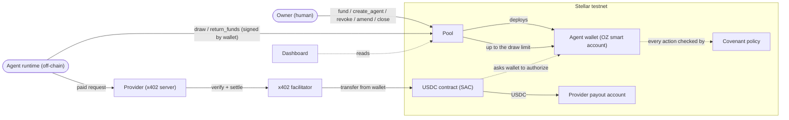
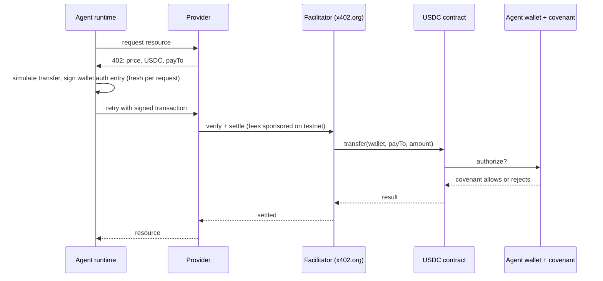

# Kovan: project plan

**HackMeridian 2026** · Lisbon · Track: Genesis + Stellar Composed, *"Agents that spend"* · **Stellar testnet only**

Status as of **Sun Oct 25, 12:30 Lisbon (WET)**. Submission closes **Mon Oct 26, 12:00**, no late entries.

> **One-liner (draft):** Kovan lets an owner lock USDC in one pool and give each AI agent a wallet bound by an on-chain covenant: how much it may draw, whom it may pay, and until when. The agent can't change the rules, and the owner can freeze it at any time.
>
> **Closing line:** *"Humans configure, agents only execute inside limits."*

This doc puts the whole idea in one place for partners. The detailed sources are the [design spec](superpowers/specs/2026-10-25-kovan-covenant-design.md) and the [contracts implementation plan](superpowers/plans/2026-10-25-kovan-contracts.md) in this repo, plus the pre-event planning folder (`hackmeridian/docs/`, not in this repo).

---

## TL;DR

- **Problem:** agents that pay per call (data feeds, RPC, APIs) need money. Today you either hand them a funded wallet they can empty, or a human refills it by hand.
- **Idea:** three layers. A **pool** holds the owner's USDC. Each **agent** has its own smart-account wallet. A **covenant** is the agent's rulebook, enforced on-chain.
- **Guarantee:** an agent can never take more than its draw limit from the pool, and its wallet can only make the payments its covenant allows. That holds even if the agent is buggy, looping or prompt-injected.
- **Stellar pieces:** Soroban contracts, OpenZeppelin smart accounts with a custom policy, the USDC Stellar Asset Contract, and x402 for per-call payments.
- **Status:** covenant policy and agent wallet are built and tested; the pool contract is in progress. Testnet deploy, the agent runtime and the dashboard are next.

---

## 1. Problem

Agents that do useful work, such as monitoring or producing trading signals, pay for their inputs per call. x402 makes per-call payment possible, but where does the agent's money come from?

- **Hand the agent a funded wallet.** A buggy, looping or prompt-injected agent can send all of it anywhere.
- **Top it up by hand.** A human is in the loop for every refill, and the agent stalls in between.

## 2. Who it's for

| Role | Who |
|---|---|
| **Owner** | Backs the agents with USDC: a developer's company, or a developer acting professionally. B2B. |
| **Agent** | A monitoring or trading-signals agent that pays data/RPC providers per call. It buys data; it does not trade. |
| **Providers** | x402 resource servers (data, RPC) paid per call. |

## 3. The idea: pool, agent, covenant

| Layer | What it is | What it enforces |
|---|---|---|
| **Pool** | A Soroban vault holding the owner's locked USDC | How much each agent may **draw**. Nothing else. |
| **Agent** | An OpenZeppelin smart account (C-address) holding that agent's own funds, drawn from the pool | Signed by the agent runtime's key |
| **Covenant** | The rules attached to one agent | How much it may take, and what its wallet may do with what it holds |

In the owner's words: ***the pool is the bank; each agent's wallet is its own funds; the covenant says how much it may take and what it may do.***

**Enforcement principle:** *the covenant does not trust the rail, it trusts the allowlist.* An x402 payment and a direct USDC transfer look identical on-chain (`USDC.transfer(from, to, amount)`), so the covenant judges every payment by payee and amount, never by how it arrived.

## 4. What a covenant contains

| Part | Rule | Checked by |
|---|---|---|
| **draw** | `draw_limit`: the most USDC that may move from the pool to this agent over the covenant's life. `drawn` tracks the running total; returned funds can be drawn again. | Pool |
| **spend** | Two allowlists, each with a `per_transfer_cap` and a `total_cap`. **providers**: addresses paid per call (x402 servers, or direct payments to them). **recipients**: plain transfers, e.g. another agent's wallet or a treasury. | Wallet policy |
| **calls** | Other contract calls the wallet may make: `(contract, function, optional cap on one argument)`. Empty by default. | Wallet policy |
| **expiry** | A ledger number. After it, `spend` and `calls` refuse everything. Returning funds still works. | Wallet policy |
| **lifecycle** | `return_funds`, `settle`, `dispute`, `delegate` (see §5). | Pool |

**A payment passes only if all of these hold:** the asset is the USDC contract · `0 < amount ≤ per_transfer_cap` · the list's running total stays within `total_cap` · the payee is on that list · current ledger is before `expiry` · the covenant isn't revoked. A transfer back to the pool is always allowed.

## 5. Who can do what

**Owner** (on the pool; every call requires the owner's signature)

| Function | Effect |
|---|---|
| `fund(amount)` | Locks USDC in the pool |
| `create_agent(params)` | Creates the agent wallet with its covenant. Fails if total draw limits would exceed locked funds. |
| `amend(agent, limits)` | Changes numeric limits only (`draw_limit`, caps, `expiry`). Can't break the pool invariant or cut below `drawn`. Allowlists are fixed: close and recreate to change them. |
| `revoke(agent)` | Freezes `spend` and `calls`, for the agent and all of its children. Funds can still go back to the pool. |
| `close(agent)` | Final. Requires `drawn == 0`; frees the agent's draw limit. |
| `withdraw(amount)` | Takes out unassigned funds: `locked − Σ draw_limit` |

**Agent** (signed by the agent's wallet)

| Function | Effect |
|---|---|
| `draw(amount)` | Moves USDC from the pool into its own wallet, up to its draw limit |
| `return_funds(amount)` | Sends USDC back to the pool. Always allowed, even after expiry or revocation. The owner can also trigger it without the agent's signature. |
| `settle()` | Asks to wind down; the owner confirms with `close()` |
| `dispute(evidence_hash)` | Records an objection on-chain. The owner rules; no funds move automatically. |
| `delegate(child_params)` | Creates a child agent with a narrower covenant carved out of its own remaining allowance (see below) |

**Delegation.** A child's draw limit is at most the parent's remaining allowance (`draw_limit − drawn`) and is deducted from the parent. The child's allowlists and caps must be subsets of the parent's, and its expiry can't be later. Revoking a parent revokes its children. A parent can revoke and close its own children; a closed child's limit returns to the parent, not the pool.

## 6. Guarantees (each one has a test that fails if the rule breaks)

1. Total draw limits across active agents never exceed the USDC locked in the pool.
2. No agent draws more than its own draw limit.
3. A transfer is refused for: wrong asset · payee on no list · amount 0 · negative amount · amount over the per-transfer cap · list total exceeded · after expiry · revoked.
4. A contract call is refused for: contract/function not listed · capped argument exceeded · after expiry · revoked.
5. Non-owners can't call owner functions; non-agents can't call agent functions.
6. A revoked agent can't draw, and neither can its children.
7. A child covenant can't exceed its parent on any dimension.
8. Returning funds to the pool works after expiry and after revocation.

## 7. Architecture

Four Soroban contracts (Rust, `soroban-sdk` 28.0.0, OpenZeppelin `stellar-accounts` 0.8.0, target `wasm32v1-none`):

| Contract | Role |
|---|---|
| `kovan-pool` | Holds the owner's USDC, deploys agent wallets, enforces draw limits and the lifecycle |
| `kovan-agent-account` | The agent's wallet: an OZ smart account, frozen at creation |
| `kovan-covenant-policy` | The covenant rules, plugged into each wallet as an OZ policy |
| `kovan-ed25519-verifier` | Checks the agent key's signatures (copied from the OZ example) |

**Why the agent can't change its own rules.** The wallet has exactly one rule: the agent's key, checked by the covenant policy. There is no rule that covers the wallet's own admin functions, so nobody can add signers or remove the policy, ever. The policy also refuses any call the wallet makes to itself.

**How the owner pulls funds back without the agent's key.** When the wallet is created it grants the pool a USDC allowance. The pool can then move funds from the wallet back to itself. The policy blocks the agent from using `approve` or `transfer_from` on USDC, so the agent can't forge or abuse that path.

**How an x402 payment works.** The agent's wallet is a smart account (C-address), and the standard `@x402/stellar` client only signs for regular G-accounts. So the agent runtime builds the payment itself:

The x402 spec and the facilitator's checks both allow a C-address payer; this was verified from source. It has **not yet been settled live on testnet**. That happens at the facilitator gate (Sun 16:00–18:00). **Fallback:** an owner-held G-account sized to the draw limit pays instead. Losses stay capped, but the rules at the payer are then enforced off-chain, and we say so openly in the pitch.

## 8. Why Stellar

- **USDC + Stellar Asset Contract:** contracts move real-issuer USDC (testnet here) directly.
- **OpenZeppelin smart accounts + custom policies:** the rules live on the wallet itself, on-chain, not on our server.
- **x402 on Stellar:** per-call payments with existing facilitators; x402.org sponsors fees on testnet.
- **Low fees:** per-call payments of a few cents still make sense.

## 9. Scope

| In scope | Out of scope (roadmap) | Never |
|---|---|---|
| Pool, agent wallets, covenant policy, verifier | Reputation (stellar-8004) | Any path where an agent takes more than its draw limit |
| Draw, spend, calls, expiry, lifecycle, delegation | Limits that grow with good behaviour | Any wallet action the covenant didn't explicitly allow |
| x402 payments from the agent wallet | Default handling / loss sharing | Keys or wallets generated by AI |
| Testnet deploy, agent runtime, dashboard (read-only is fine) | MPP, trading, mainnet, cross-chain | LLM/inference costs paid from pool funds |
| | A dispute court (disputes are owner-ruled) | Off-chain spending rules ("if the policy can't check it, it isn't a rule") |

## 10. What changed from the pre-event plan

The pre-event docs describe an earlier version called **"Action Bonds"**. Kovan replaces it:

| Action Bonds (pre-event) | Kovan (now) |
|---|---|
| Vault + factory + one contract per agent + bond policy | Pool + frozen agent wallet + covenant policy (fewer contracts) |
| Agent requests a fixed-size bond and repays it | Agent draws up to its draw limit and returns funds when it wants |
| One allowlisted provider per agent | Two allowlists (providers, recipients) plus an optional contract-call allowlist |
| Limit ladder $0.50 → $2 → $10 → $50, score on stellar-8004 | Dropped for the hackathon; on the roadmap |
| Public `liquidate()` after expiry + loss waterfall | Dropped. After expiry the wallet can only return funds; the owner can pull them back at any time. |
| No delegation | Agents can create narrower child agents |

## 11. Build plan and timeline (Lisbon time)

| When | Checkpoint | Contract tasks | Fallback if late |
|---|---|---|---|
| Sun 16:00 | Contracts + failing-violation tests | 0–5: workspace, verifier, covenant types, covenant rules, agent wallet, pool core | Cut in this order: `dispute` → `calls` → `settle`/`close` → `amend`. Covenant rule tests are never cut; `delegate` stays. |
| Sun 16:00–18:00 | **Facilitator gate**: one live x402 payment from the agent wallet | — | Owner-held G-account pays instead; record GO/FALLBACK in the README |
| Sun 18:00 | Lifecycle + testnet deploy | 6 (revoke, amend, settle, close, dispute), 8 (deploy script) | Deploy whatever compiles; IDs into the README |
| Mon 01:30 | Full loop + dashboard | 7 (delegation), 9 (signed end-to-end test, no mocks) | Task 9 can be replaced by a real testnet tx from the runtime; static dashboard from recorded tx hashes |
| Mon 04:00 | Backup video, unlisted on YouTube | — | Local recording, kept in two places |
| Mon 09:00 | **Freeze**: fixes, README, video, deck only | — | Revert to the last checkpoint tag |
| Mon 11:00 | Submit | — | Submit whatever exists by 11:30; 12:00 is final |

The agent runtime (the x402 payment builder) and the dashboard get their own plans; they're not written yet.

## 12. Where we are now

| Piece | State |
|---|---|
| Workspace + ed25519 verifier (tasks 0–1) | Done |
| Covenant types, storage and rules (tasks 2–3) | Done, **30 tests passing**: every spend/calls rule, expiry boundary, negative and zero amounts, muxed payees, self-calls, `approve` on USDC, revocation |
| Agent wallet (task 4) | Done, **5 tests passing**: single frozen rule, pool allowance, management calls rejected, needs no signatures at creation |
| Pool core (task 5) | In progress, not committed yet: fund, create_agent, draw, return_funds, withdraw, with 13 tests written |
| Lifecycle, delegation, deploy, signed e2e (tasks 6–9) | Not started |
| Agent runtime (x402) | Not started |
| Dashboard | Not started |
| Testnet deploy + tx evidence | Not started |
| Pitch, deck, video | See §13 |

## 13. Demo (draft, needs team sign-off)

The old three-beat script (limit rises, blocked payment, slashed default) no longer fits. Proposed beats for Kovan:

1. **The agent pays its way** (~40 s). The owner has locked testnet USDC and created an agent. The agent draws its allowance and pays a data provider per call over x402. The dashboard shows the pool, the draw limit and each tx.
2. **Blocked payment** (~40 s). The agent is tricked into paying an address that isn't on its list, or more than its cap. The covenant rejects it on-chain. Show the failed transaction.
3. **Kill switch + money back** (~40 s). The owner revokes the agent: its next payment fails. The owner pulls the remaining USDC back into the pool without the agent's key.
4. *(if time)* **Delegation.** The agent creates a child with a smaller limit and a narrower list; the child can't exceed its parent.

Close: one architecture slide, the roadmap in one breath, then *"Humans configure, agents only execute inside limits."*

## 14. Risks and objections

| Risk / objection | Impact | Mitigation | Status |
|---|---|---|---|
| **The agent wallet as an x402 payer hasn't been tested live** | Core demo path | Facilitator gate Sun 16–18; owner-held G-account fallback | Verified from source, live test pending |
| "Isn't this just a prepaid wallet?" | Innovation score | One pool backs many agents; unused limits stay with the owner; the wallet can't be reconfigured; owner can freeze it and pull funds back without the agent; delegation | Answer ready |
| Demo failure (testnet, RPC, facilitator, Wi-Fi) | Progress + UX score | Backup video by Mon 04:00; log tx hashes as we go; hotspot | Open |
| USDC is freezable by its issuer | Judge question | Disclose it; it's the asset's design. Funds can still return to the pool. | Answer ready |
| AI-made keys or AI costs in the budget ("Cavos lesson") | Credibility | Humans make every key with official Stellar tooling; no LLM spend from pool funds | Rule set |
| OZ negative-amount concern | Policy bypass | The covenant checks `0 < amount` itself; tested | Handled |
| OZ v0.8.0 signing change | Signatures fail | Pinned to 0.8.0 end to end | Handled |
| Stale x402 auth entries | Random payment failures | Sign per request, never cache | Rule set |
| Testnet reset wipes evidence | Progress score | Screenshots, video and hashes in the README | Open |
| Secrets committed to the public repo | Key leak | `.env` ignored from the first commit; scan before submit | Open |
| One builder is the bottleneck | Scope slip | Hard cut order (§11) | Open |

## 15. Judge Q&A (draft)

- **Why not MPP?** MPP can't pay from smart accounts, and our safety comes from a policy on the agent's smart account. x402 on Stellar can, and has facilitators today.
- **Is this trading?** No. The agent buys data. Its wallet can only pay addresses on its lists, so trading with pool funds isn't possible.
- **Do you hold anyone's funds?** No. The owner's USDC sits in a pool the owner controls; the team holds no keys. (If we ship the fallback payer, that G-account is held by the owner, not by us.)
- **What if the agent is prompt-injected?** The covenant caps the damage: listed payees only, within caps, before expiry. Worst case is the agent's draw limit.
- **Isn't this a prepaid wallet?** See the risk table above. Then point to demo beats 2 and 3.
- **How is this different from REAPP / Rail402?** We build on the same idea of agents paying per call; we add one pool backing many agents with on-chain rules the agent can't change. *(Re-read their current docs first so the comparison stays fair.)*
- **What did AI build?** Listed in `AI_USAGE.md` and marked by `[ai]` commits. No AI-made keys.

## 16. Compliance stance (not legal advice)

- **B2B, non-custodial.** An owner backs its own agents with its own (testnet) USDC. The team holds no keys.
- **No return to the owner.** The only thing that comes back is the owner's own USDC.
- **We issue no token.** USDC is the issuer's.
- **No personal data** on-chain or in the dashboard.
- **Human oversight:** the owner can revoke at any time; expiry is automatic; the covenant is a hard limit the agent can't change.
- **May say:** "Testnet only." "The team holds no keys to the owner's funds." "Designed with MiCA, AML, GDPR and the AI Act in mind." **Must not say:** that it's approved, licensed or "compliant"; anything that sounds like a return on locked funds.
- **Wording:** say pool, covenant, draw limit, providers, recipients, revoke, return funds. Avoid lending, investment and return-on-capital language.

## 17. Roadmap (nothing here is promised)

| Item | What it adds |
|---|---|
| Reputation on stellar-8004 | An agent's track record follows it to other owners |
| Earned limits | Draw limits that grow with good behaviour |
| Cross-chain funding (CCTP) | Owners fund the pool with USDC from other chains |
| Private pools | Owner balances and limits aren't publicly visible |
| Mainnet + KYB | Real USDC, business-only onboarding, provider screening. Needs an audit and counsel sign-off first. |

## 18. Team and working rules

| Member | Owns |
|---|---|
| HackieMeredian | Build: contracts, agent runtime, dashboard, deploys |
| ChattieGPT | Pitch, video, deck |
| Claudie | Risks, compliance, judge Q&A |
| Stellar Ravien | Stellar fact-check, contract IDs, tx evidence |

- Every commit with AI-written code starts with `[ai]`.
- Humans generate every key with official Stellar tooling. Never paste a secret into an AI chat.
- Tag a working commit at every checkpoint. Log tx hashes into the README as they happen.
- At every checkpoint: if it isn't done, take the fallback. Don't extend.

## 19. Decisions we need from partners

**Calls already made; flag any you disagree with**
- [ ] Delegation is in scope, and stays in when cutting.
- [ ] Disputes are recorded on-chain and ruled by the owner; no automatic payouts.
- [ ] Returned funds go to the pool, not to an owner address.
- [ ] `amend` changes numbers only; changing allowlists means close and recreate.
- [ ] The agent wallet has no admin at all (frozen at creation).
- [ ] Cut order if Sun 16:00 slips: `dispute` → `calls` → `settle`/`close` → `amend`.

**Still open**
- [ ] Demo beats (§13): agree, or change.
- [ ] Demo provider: whose x402 server, and what does it sell (data or RPC)?
- [ ] Covenant expiry for the demo (short enough to show on stage?).
- [ ] Dashboard: read-only, or can the owner act from it?
- [ ] Demo owner: the developer's own company, or a separate party? This affects the B2B story.
- [ ] Who records the voice-over and owns the YouTube upload?
- [ ] Overnight rotation: who is awake at 01:30 and 04:00?

## 20. Submission checklist (short)

- [ ] Public repo, opens logged out
- [ ] README filled: one-liner, problem, user, solution, live URL + video, how Stellar is used (contract IDs + tx table), setup, env vars, demo, built during the event vs prior work, AI usage, compliance, roadmap, team, testnet disclaimer
- [ ] Video 2–4 min on YouTube/Vimeo, plays logged out
- [ ] Deck (PDF/PPTX/HTML, under 20 MiB)
- [ ] Live dashboard URL works in a private window
- [ ] Every tx hash in the README opens in an explorer
- [ ] No secrets in the repo or its history; `[ai]` commits and `AI_USAGE.md` complete

---

*Hackathon prototype on Stellar testnet only. Testnet USDC has no value. Not audited. Not a financial product. Not legal advice.*
